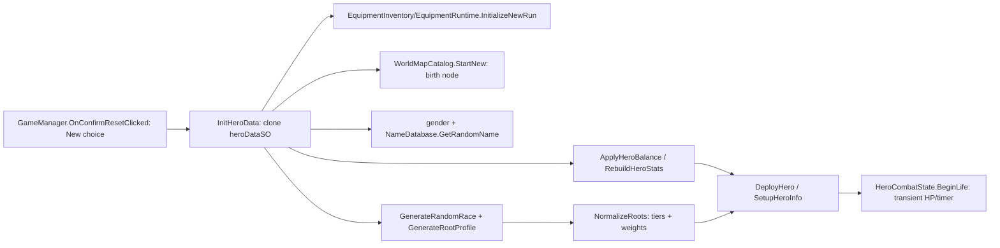
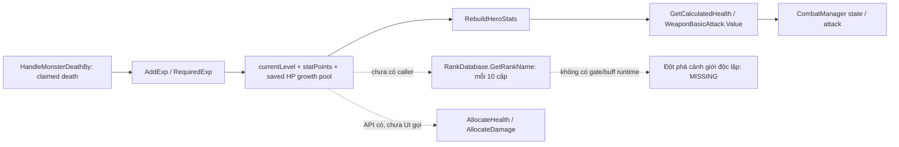
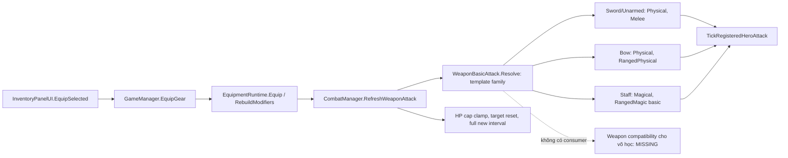
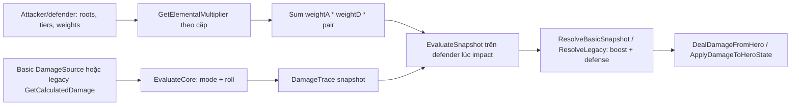
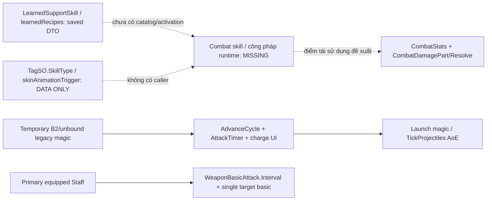
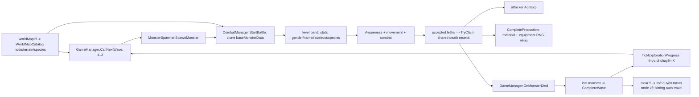
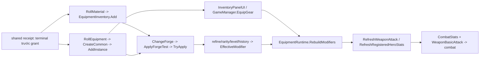

# Gameplay dependency map

Mốc nguồn: `0944519c46610e79238c027c83ae9ea023c984c3`, branch `feature/monster-awareness-ambush`. Đây là call/data flow được đọc từ mã, không phải sơ đồ kiến trúc đích. Mũi tên liền = caller/data path đã tìm; mũi tên chấm = điểm thiếu/ý tưởng tích hợp, **không phải đường đang chạy**. Phân loại và rủi ro chi tiết ở [audit](GAMEPLAY_SYSTEM_AUDIT.md).

## 1. Character creation → roots → stats

Entry: New qua confirmation của GameManager; verifier trước dùng cùng Init/Deploy handler, không thay thế pipeline. Input: heroDataSO, RNG, catalog world-map và tùy chọn DEVB. Output: một `runtimeHeroData` canonical + state chiến đấu. Root không tự tạo Attack modifier; tác động root diễn ra trong damage evaluator, không phải một bonus mặc định vào baseDamage.

Save: identity/gender/race/root tiers/weights, growth/points và inventory/world state nằm trong EntityDataSO; HeroCombatState runtime không lưu. Test có sẵn: Balance/ElementWorld/GearDrop; chưa có test mới được chạy trong audit.

## 2. Level / realm → progression → combat stats

Input: EXP kill (Hard ×3 khi đang Hard), currentExp/level/growth và DEVB nếu có. Output: mức cấp tiếp theo, points, base Attack/HP/speed/exp requirement; HP cap còn phụ thuộc weapon mode. Save toàn bộ progression này rồi normalize/rebuild khi tải.

`RankDatabase` không là authority stat/gate hiện tại; không nối mũi tên Rank → buff. Hai helper level advantage/weapon-level penalty trong SynergyMath chưa được caller combat sử dụng. Test: `BalanceRegression`, `SaveRollbackRegression`; chưa tìm thấy test trực tiếp Rank/realm gate. Hướng nối presentation realm không cần Save field mới; independent gate chưa có đặc tả.

## 3. Weapon → basic attack → compatibility

Input: instance ID hợp lệ, catalog family, slot, canonical equipped flags. Output: mode/range/HP/timer/presentation và stats từ đúng item; không có class/profession gate. Save item+slot; `savedAttackMode` chỉ cache legacy. Load bind lại Hero và resolve family từ item. Test: WeaponBasicAttackRegression/GearDropRegression; historical Unity cycle đã thấy Cung, không phải native click.

Nhánh B2 khác: `RegisterAdditionalHero` bind `temporaryCompanion=true` → legacy mode. Không giả định B2 có persistent loadout hoặc cần mở rộng theo định hướng một Hero.

## 4. Spiritual roots → interaction → damage

Nguồn root profile được snapshot vào projectile trace; defender được đánh giá tại impact. Basic hiện cũng đi qua root weighting. CombatDamagePart.element/school và root cặp là hai lớp khác nhau: basic snapshot dùng element Vô cho boost/resistance, không tự dùng itemElement. Input/output và điều kiện tags được định nghĩa ở `TuTienEnums.SynergyMath`, `CombatDamage`, `CombatStats`; Save roots/modifiers/item rolls, không Save trace/projectile. Test: ElementWorld/Version0051Stats/weapon tests. Chưa có đường root → điều kiện học/chọn công pháp.

## 5. Skill / công pháp → casting → effects

Không có entry point học/trang bị skill hoặc công pháp đang được gọi. Legacy charge là automatic attack timing, không phải một ability được học có cooldown/mana riêng. Primary Staff không dùng charge/AoE legacy. `CultivationSpriteBridge` chỉ sprite states.

Save: learned support DTO round-trip; không tìm thấy combat loadout/skill cooldown/mana/realm state. Test: JSON Save fixtures chỉ chứng minh DTO; weapon/B2/Magic regression liên quan legacy attack, không chứng minh hệ võ học. Trạng thái chuỗi công pháp/skill là MISSING runtime; không chuyển tên DTO thành bằng chứng đã có hệ hoạt động.

## 6. Monster / environment → wave / map → reward

Đường spawn được release sau entry/VFX; không phải cứ 5 giây tạo wave. `WaitAndCallNextWave` hiện phục vụ replay escaped wave; wave clear thường dùng distance. AI/vị trí không được viết lại để ép bố cục UI.

Input: node/legacy map state, base monster SO/prefab, RNG. Output: runtime lives, EXP/rewards, world wave/clear history. World suggested level theo depth birth (±1 khi spawn), legacy theo Hero spread; Hard scale damage/EXP, không scale loot. Save node/clear/wave, không Save pooled object hoặc death receipt. Boss flag/data và travel block có thật nhưng không có boss encounter pipeline. Tests: WorldMap/ElementWorld/MonsterAwareness/CombatLoot/ProductionReward; chỉ lịch sử test, không chạy trong audit.

## 7. Equipment / Forge → derived stats → combat

MainGame author: material .60/qty1–2; gear .08/Uniform Sword-Bow/level1/Attack4/Common. Không có recipe RNG, gold sink, nghề prerequisite hoặc item generation mới trong flow này. Nhánh lỗi độc lập, không retry/reroll/rollback phần đã commit; animation không cấp thưởng lần nữa.

Modifiers có hai ownership riêng: `equipment:instance:` và `equipment:primary-trinket`; rebuild không xóa modifiers nguồn khác. Normal/Special tiêu 1/10 material, hiệu lực scale từ stat gốc, không roll lại affix. Save cả item roll/progression/history và modifiers; Load normalize/rebuild prefix để tránh cộng lại. Test: GearDrop/EquipmentStatPreview/MultiSlot/Affix/SaveLoad; native GearDrop report xác minh đường thật với chance fixture=1, không chứng minh balance 8%.

## 8. Các hệ → Save / Load

```mermaid
flowchart LR
    Data["EntityDataSO canonical: identity/root/level/map/bag/gear/history/DTO"] --> Triggers["Manual / AutoSaveRoutine / ReturnTitle / Travel"]
    Triggers --> Save["SaveManager.SaveGame: version guards + ToJson"]
    Save --> File["slot .tmp -> Replace/Move .json"]
    File --> Load["TryLoadSlot: new snapshot -> LoadGame"]
    Load --> Guard["precheck versions; FromJsonOverwrite; verify progress"]
    Guard --> Normalize["Roots/Map/Stats/Inventory/Equipment normalize + rebuild"]
    Normalize --> Swap["runtimeHeroData swap; cancel old entry/combat/UI"]
    Swap --> Bind["RestoreSelectedStance / DeployHero / SetupHeroInfo"]
    Bind --> Fight["new runtime HP/timer/life identity"]
```

Input: slot, JSON, supported per-component versions; GameManager không mutation runtime Hero hiện tại trước khi snapshot mới load hợp lệ. Direct `SaveManager.LoadGame(existingHero,...)` không được suy là rollback transaction trên object cũ; dùng manager đường snapshot hiện có.

**Lưu:** tên/gender/race/root profile, level/EXP/point/growth, legacy/world map progression, inventory stacks, item IDs/equipped slots/stat lines/Forge history, gold và DTO nghề/recipe/support. **Không lưu:** B2, active targets, HP hiện thời/timer/projectile/live monster identities, receipt ledger, UI modal, config reward và DEVB settings (file riêng), realm gate/combat-skill state chưa có. Load/Retry/Travel bắt đầu combat mới theo policy hiện tại, không phải resume giữa frame.

Tests hiện có: native JsonUtilitySaveLoadTests/EquipmentVersionGuardTests/SaveLoadPlayModeTests và Mono SaveRollback; MainGame GearDrop verifier từng xác nhận Save/Load rồi đánh lại. Audit không rerun. Thêm realm/skill state về sau phải có compatibility plan, không dùng field profession/enum số cũ làm nghĩa mới.

## Những cạnh chưa được chứng minh

- Rank name → UI/stats/gate: không có caller; chỉ nên nối presentation sau khi thống nhất phạm vi.
- DTO support skill/recipe → hiệu ứng/craft action: chưa có consumer nghiệp vụ.
- Weapon/root conditions → learned skill: chưa có definition/loadout/activation.
- Stat CastSpeed/CDR/ManaRegen → scheduler/pool: chưa tồn tại consumer.
- Boss node → boss gameplay: đang bị gate, metadata không đủ thành encounter.
- Story/sect branching → save/world consequences: UNKNOWN trong audit gameplay local này; không suy membership/class từ nhãn map.

Các cạnh chấm không phải backlog đã được cấp quyền triển khai. Xem [roadmap](INTEGRATION_ROADMAP.md) để biết thứ tự, điều kiện và quyết định cần thiết.
