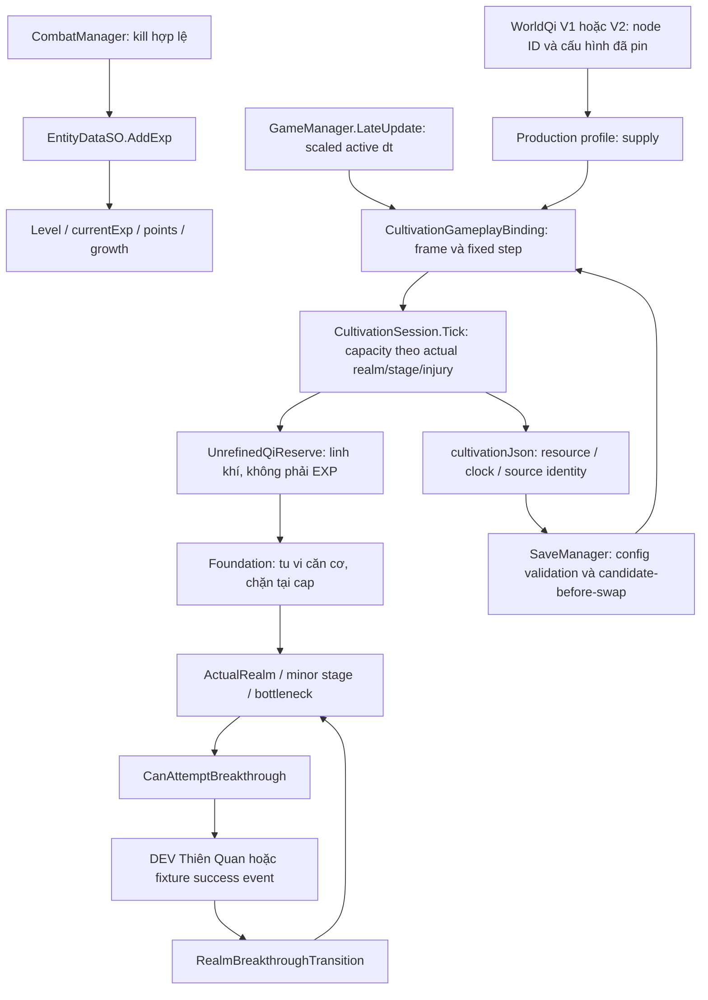

# Dual Progression — Cloud audit, 12/11/2026

## Nền và phạm vi

Nhánh `feature/cloud-dual-progression-audit`, base
`development_0.1.7` tại `fafc02d613a2e6a15c72a8dd48b935d2faa54f0e`.
Working tree ban đầu sạch; đã fetch toàn bộ origin và kiểm tra PR đang mở,
gồm #12/#13/#16/#17/#18. Các thành phần Engine/Breakthrough/Capacity/Binding/
Blood/Persistence/WorldQi và Resources production hiện hành trùng các nhánh
mới hơn. Chọn nền này để giữ đầy đủ tu luyện v1.1/Development trial v0.1.5 mà
không phụ thuộc animation, truyện, Weather hoặc Item Catalog của PR khác.
`main` chưa có bộ tu luyện này. Không merge, rebase hoặc cherry-pick.

Đã đọc `AGENTS.md`, các skill dự án/Unity/Save, core loop, Dual Progression,
Blood Essence, Capacity, World Qi V1/V2, balance, Thiên Kiếp, migration và báo
cáo v0.6/v0.7/v0.9/v1.1/0.1.5/0.1.7 liên quan. Tài liệu v0.6 còn các gate
lịch sử: kết luận dưới đây ưu tiên mã hiện tại và yêu cầu task mới.

## Luồng production đã truy vết

EXP không đi vào Q/F. Không có nhánh EXP reserve hoặc Mastery trong luồng
hiện tại. Production chưa có successor và từ chối trial; nhánh D chỉ chạy ở
Development/fixture đã cấu hình. Không suy diễn domain PASS thành retail unlock.

## Đã có, chưa nối và discrepancy với yêu cầu

| Hạng mục | Mã hiện tại | Trạng thái so với task / vị trí |
| --- | --- | --- |
| Hai nguồn EXP/Qi | Combat kill gọi AddExp; Tick chỉ xử lý Qi/reserve/foundation/energy | **Đã có**. `CombatManager.cs:793`, `EntityDataSO.cs:290`, `CultivationEngine.cs:61`. |
| Bình cảnh và EXP dự trữ | AddExp vẫn tăng Level tại bình cảnh, không có EXP bank; reserve là Qi | **DISCREPANCY**. Yêu cầu mới đòi dự trữ rồi giải phóng EXP; chưa có biến/quy tắc release trong runtime. Không đổi schema hoặc tạo hệ Level song song. |
| Không mất EXP ở bình cảnh | Không có realm gate trong AddExp; EXP tiếp tục dùng để lên Level | **Characterization**, không tương đương bank/release. Level999 có cap EXP riêng; không dùng đó làm bằng chứng EXP reserve. |
| Weapon/Skill Mastery | Truy vết AddExp, weapon basic attack, registry, combatSkills/weapon skill callbacks không thấy state/award Mastery | **CHƯA TRIỂN KHAI**; không thể chạy test Mastery tăng ở bình cảnh. Không dùng learned/queue/cooldown thay cho Mastery. |
| Tích luỹ Qi tại cap | Foundation giữ cap, Qi tiếp tục vào reserve trong giới hạn absorption | **Đã có**; không mất hoặc tiêu reserve khi gain0. |
| Liên tiếp đột phá | Domain explicit success/revision/epoch; có thể luyện reserve rồi đi tiếp không cần Level | **Đã có domain**, test ba success khác nhau. Production chỉ Luyện Khí, successor rỗng; `CultivationProductionConfiguration.cs:43`, `GameManager.Tribulation.cs:20`. |
| Thiên Kiếp | v1.2 two-phase domain; v1.3/0.1.5 DEV Thiên Quan, combat/result Save transaction | **DEV/fixture**, production gate false; không phải thiếu toàn bộ implementation. `CultivationIntegrationGate.cs:9`. |
| Kim Đan/Tinh Huyết | Domain catalog cho capacity1 tại entry và +1 mỗi minor stage; thụ động, HP<30%, heal đầy, duration30s/top-up, debt | **Đã có domain**, **khóa gameplay**. Profile tạo realms không Blood; production rate0/cap0. `CultivationPlaytestProfile.cs:54`, `CultivationGameplayState.cs:78`. |
| Buff một đại cảnh giới | Effective tier+1 chỉ cho CombatAbility có forced support; không đổi actual realm | **Đã có domain**, không cộng dồn khi extend; chưa nối skill/HP/combat runtime. |
| Nhân đôi mọi stat không phần trăm | Whitelist hiện chỉ Attack, MagicalAttack, Armor, MagicResistance, HealthRegeneration, KillHealBonus | **DISCREPANCY**: loại MaxHealth, AttackSpeed, MovementSpeed và các stat khác. `BloodEssenceTransactions.cs:59`. Không mở rộng buff hoặc đổi balance trong audit. |
| Debt10% mỗi charge | ReferenceFoundation × configured ratio × ChargesUsed; fixture0.1, thiếu căn cơ thành injury, actual realm giữ nguyên | **Đã có domain**; rate/ratio production Blood chưa được cấu hình/duyệt. Không khẳng định game đang thiêu đốt10%. |
| Hồi Căn Cơ | Tick luyện Qi bù foundation đã mất; HealInjury/InjuryTreatmentSession chữa injury riêng | **PARTIAL**. PassiveNurturing có API, chưa được GameManager tick tự động. Tu luyện thường không tự xoá injury; `CultivationEngine.cs:114`, `FoundationRecovery.cs`. |
| World Qi | 133 node, tám tier0.6..5Qi/s, source config/fingerprint/seed giữ nguyên, source theo node | **Đã có**. V2 seed20261106; bảng tạo offline từ spatial field. |
| Vùng dày/thưa trong cùng map | Binding chỉ nhận nodeId; không nhận tọa độ Hero hoặc sample heatmap trong BattleArea | **DISCREPANCY**. Spatial correlation giữa các node có thật, không phải density thay đổi theo vị trí Hero trong một node. `CultivationPlaytestProfile.cs:39`, `CultivationGameplayState.cs:111`. |
| Công pháp/vật phẩm ảnh hưởng Qi | CapacityModifier hỗ trợ Root/CultivationArt/EquipmentOrTreasure, immutable và bounded | **Cấu trúc/fixture**, production không cấp modifier từ item/art/root hiện hành. Không tự nối Inventory/Forge. |
| Pause/Travel/Retry/offline | Một binding clock, dt scaled, frame/owner guard; Travel settle fraction tại source cũ, Dispose/Rebind ở lifecycle | **Đã có mã**; không offline grant. Native gameplay chưa chạy phiên này. `GameManager.Cultivation.cs:53`, `GameManager.cs:1243/1295`. |

Các discrepancy không được đánh dấu PASS chỉ vì characterization test mô tả
đúng mã cũ. Thiếu EXP bank/Mastery/successor/activation/spatial sampler cần một
nhiệm vụ thiết kế và tích hợp riêng; không tự thêm save fields hoặc policy mới.

## Regression và lỗi đã tái hiện — checkpoint đầu

Runner `Tests~/DualProgressionAudit/run.sh` tái sử dụng nguyên bốn bộ regression
Core/Blood/Breakthrough/Persistence hiện có (19 nhóm), thêm chín nhóm audit.
Không thay công thức production bằng mock. Các lớp Item/Combat phụ thuộc chỉ
được biên dịch, không sửa. Boundary môi trường không liên quan ném lỗi nếu gọi.
DTO cấu hình đọc bằng .NET JavaScriptSerializer rồi qua production validators;
không dùng parser mô phỏng để tạo profile số giả. JSON component dùng UnityStub
có sẵn: không phải Unity serializer hoặc SaveManager gameplay.

**26 PASS / 2 FAIL trước sửa**:

1. `CultivationComponentCodec.Capture(..., target)` không xoá các field burn cũ
   khi session đã settle. Dùng lại target giữ `hasBurn`/ID/debt cũ, làm snapshot
   mâu thuẫn với receipt đã trả nợ.
2. Capture lặp vào cùng target append settled IDs thay vì thay snapshot, gây
   duplicate receipt và candidate restore bị reject; target có list null cũng
   chưa được khởi tạo lại.

Đây là lỗi API DTO có thể tái hiện trong domain. Binding gameplay hiện tạo DTO
mới mỗi lần Publish, và Blood đang khóa; chưa có bằng chứng lỗi này xảy ra qua
SaveManager/MainGame. Bản sửa dự kiến chỉ cập nhật codec, không đổi schema,
clock, buff, balance hoặc policy recovery.

## Mô phỏng mục tiêu60 phút

Đã kiểm tra `CultivationBalanceSimulation`, `DualProgressionV06Verifier`,
`CultivationV11CapacityVerifier`, `WorldCultivationBalanceV10Verifier`. Driver
Cloud dùng đúng binding/session/capacity và LastStepFlow như verifier v1.1;
không tạo model cân bằng mới. Helper `CultivationBalanceSimulation.Run` cũ có
assertion reserve/timing của profile cũ; không dùng làm helper tổng quát cho V3.

**17 phép đo**, mỗi phép chạy3660 giây gameplay hoạt động: tám tier thực từ
WorldQiV2, cả năm điểm khởi đầu, 10/30FPS ở start/hotspot, checkpoint khôi phục
trong bộ nhớ, và start của config1/2. Không công pháp/vật phẩm/modifier, không
EXP/kill, initial foundation/reserve0. SHA của WorldQi/config/capacity được
kiểm tra trùng fingerprint trước kết luận.

| Qi môi trường | Foundation sau3600s active | Viên mãn tại active seconds | Reserve sau3660s |
| --- | ---: | ---: | ---: |
|0.6|2160|Chưa đạt trong3660s|0|
|0.8|2880|Chưa đạt trong3660s|0|
|1.0 / cả năm start|≈3600|3600.1|≈60|
|1.3|3600|3304.3|1068|
|1.8 /2.5 /3.5 /5.0|3600|3304.3|1506.675|

Điểm khởi đầu đạt **60 phút +0.1 giây active**, sai khác một fixed step0.1s,
không cộng epsilon để ép cap. Hotspot khoảng55 phút4.3s; supply cao bị absorption
cap1.2→1.35→1.5 và refinement1→1.08→1.16 giới hạn. Low supply thiếu đầu vào.
Không tự sửa thông số khi kết quả khác60 phút ở map khác.

Sai số bảo toàn lớn nhất **3.42e-9 Qi**. Cả17 phép đo chạy tăng tốc trong khoảng
27.21 giây thực thi trên Cloud; đây không phải chơi thực60 phút hoặc benchmark
Player. 3600 active giây tương ứng3600 wall giây chỉ khi timeScale1, Hero hoạt
động liên tục, không Pause/death/entry/delta bị reject. Ngày–đêm game và
WorldClimate13 phút/ngày không tham gia công thức; thời gian offline được0 credit.

## Chưa nghiệm thu và checkpoint tiếp

Unity Edit/Play Mode, Windows Player, SaveManager disk recovery, thật sự chết/
Retry/Travel, Blood trong combat, Mastery và EXP bank **NOT TESTED/NOT IMPLEMENTED**
theo phân loại ở bảng trên. Không đọc/ghi/xoá save người chơi. Bản sửa DTO,
validation cuối, commit và checklist tích hợp sẽ được cập nhật cùng Draft PR.
