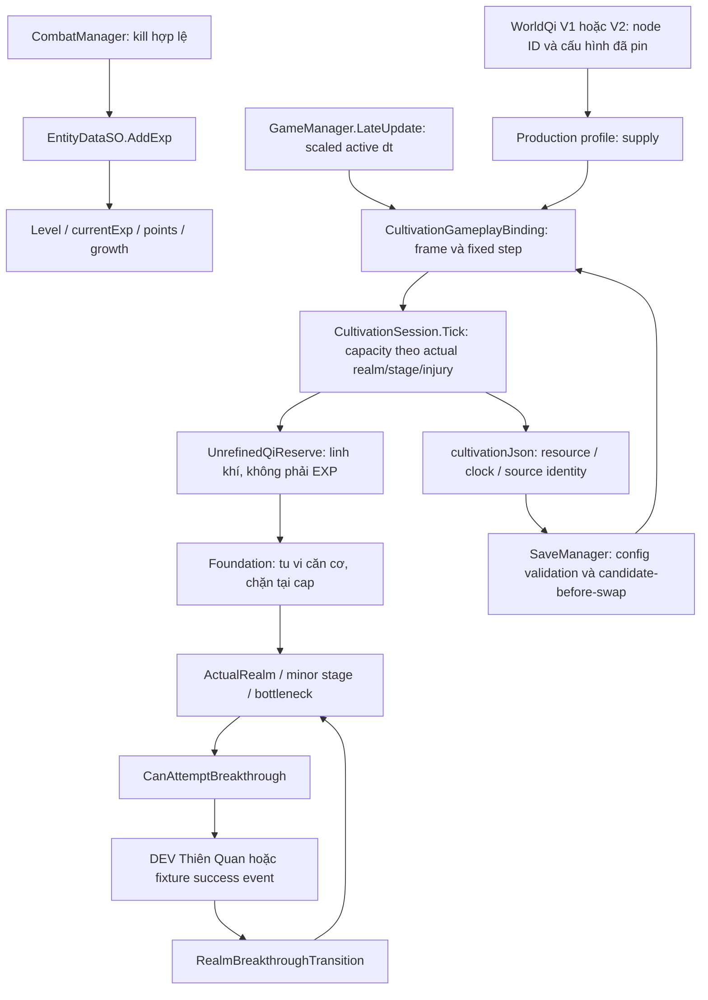

# Dual Progression — Cloud audit, 12/11/2026

## Nền và phạm vi

Nhánh `feature/cloud-dual-progression-audit`, base
`development_0.1.7` tại `fafc02d613a2e6a15c72a8dd48b935d2faa54f0e`.
Working tree ban đầu sạch; đã fetch toàn bộ origin và kiểm tra PR đang mở,
gồm #12/#13/#16/#17/#18. Các thành phần Engine/Breakthrough/Capacity/Binding/
Blood/Persistence/WorldQi và Resources production hiện hành trùng các nhánh
mới hơn. Chọn nền này để giữ đầy đủ tu luyện v1.1/Development trial v0.1.5 mà
không phụ thuộc animation, truyện, Weather hoặc Item Catalog của PR khác.
`main` chưa có bộ tu luyện này. Không merge, rebase hoặc cherry-pick.

Đã đọc `AGENTS.md`, các skill dự án/Unity/Save, core loop, Dual Progression,
Blood Essence, Capacity, World Qi V1/V2, balance, Thiên Kiếp, migration và báo
cáo v0.6/v0.7/v0.9/v1.1/0.1.5/0.1.7 liên quan. Tài liệu v0.6 còn các gate
lịch sử: kết luận dưới đây ưu tiên mã hiện tại và yêu cầu task mới.

## Luồng production đã truy vết



EXP không đi vào Q/F. Không có nhánh EXP reserve hoặc Mastery trong luồng
hiện tại. Production chưa có successor và từ chối trial; nhánh D chỉ chạy ở
Development/fixture đã cấu hình. Không suy diễn domain PASS thành retail unlock.

## Đã có, chưa nối và discrepancy với yêu cầu

| Hạng mục | Mã hiện tại | Trạng thái so với task / vị trí |
| --- | --- | --- |
| Hai nguồn EXP/Qi | Combat kill gọi AddExp; Tick chỉ xử lý Qi/reserve/foundation/energy | **Đã có**. `Assets/Script/CombatManager.cs:793`, `Assets/DataScript/EntityDataSO.cs:290`, `CultivationEngine.cs:61`. |
| Bình cảnh và EXP dự trữ | AddExp vẫn tăng Level tại bình cảnh, không có EXP bank; reserve là Qi | **DISCREPANCY**. Yêu cầu mới đòi dự trữ rồi giải phóng EXP; chưa có biến/quy tắc release trong runtime. Không đổi schema hoặc tạo hệ Level song song. |
| Không mất EXP ở bình cảnh | Không có realm gate trong AddExp; EXP tiếp tục dùng để lên Level | **Characterization**, không tương đương bank/release. Level999 có cap EXP riêng; không dùng đó làm bằng chứng EXP reserve. |
| Weapon/Skill Mastery | Truy vết AddExp, weapon basic attack, registry, combatSkills/weapon skill callbacks không thấy state/award Mastery | **CHƯA TRIỂN KHAI**; không thể chạy test Mastery tăng ở bình cảnh. Không dùng learned/queue/cooldown thay cho Mastery. |
| Tích luỹ Qi tại cap | Foundation giữ cap, Qi tiếp tục vào reserve trong giới hạn absorption | **Đã có**; không mất hoặc tiêu reserve khi gain0. |
| Liên tiếp đột phá | Domain explicit success/revision/epoch; có thể luyện reserve rồi đi tiếp không cần Level | **Đã có domain**, test ba success khác nhau. Production chỉ Luyện Khí, successor rỗng; `CultivationProductionConfiguration.cs:43`, `GameManager.Tribulation.cs:20`. |
| Thiên Kiếp | v1.2 two-phase domain; v1.3/0.1.5 DEV Thiên Quan, combat/result Save transaction | **DEV/fixture**, production gate false; không phải thiếu toàn bộ implementation. `CultivationIntegrationGate.cs:9`. |
| Kim Đan/Tinh Huyết | Domain catalog cho capacity1 tại entry và +1 mỗi minor stage; thụ động, HP<30%, heal đầy, duration30s/top-up, debt | **Đã có domain**, **khóa gameplay**. Profile tạo realms không Blood; production rate0/cap0. `CultivationPlaytestProfile.cs:54`, `CultivationGameplayState.cs:78`. |
| Buff một đại cảnh giới | Effective tier+1 chỉ cho CombatAbility có forced support; không đổi actual realm | **Đã có domain**, không cộng dồn khi extend; chưa nối skill/HP/combat runtime. |
| Nhân đôi mọi stat không phần trăm | Whitelist hiện chỉ Attack, MagicalAttack, Armor, MagicResistance, HealthRegeneration, KillHealBonus | **DISCREPANCY**: loại MaxHealth, AttackSpeed, MovementSpeed và các stat khác. `BloodEssenceTransactions.cs:59`. Không mở rộng buff hoặc đổi balance trong audit. |
| Debt10% mỗi charge | ReferenceFoundation × configured ratio × ChargesUsed; fixture0.1, thiếu căn cơ thành injury, actual realm giữ nguyên | **Đã có domain**; rate/ratio production Blood chưa được cấu hình/duyệt. Không khẳng định game đang thiêu đốt10%. |
| Hồi Căn Cơ | Tick luyện Qi bù foundation đã mất; HealInjury/InjuryTreatmentSession chữa injury riêng | **PARTIAL**. PassiveNurturing có API, chưa được GameManager tick tự động. Tu luyện thường không tự xoá injury; `CultivationEngine.cs:114`, `FoundationRecovery.cs`. |
| World Qi | 133 node, tám tier0.6..5Qi/s, source config/fingerprint/seed giữ nguyên, source theo node | **Đã có**. V2 seed20261106; bảng tạo offline từ spatial field. |
| Vùng dày/thưa trong cùng map | Binding chỉ nhận nodeId; không nhận tọa độ Hero hoặc sample heatmap trong BattleArea | **DISCREPANCY**. Spatial correlation giữa các node có thật, không phải density thay đổi theo vị trí Hero trong một node. `CultivationPlaytestProfile.cs:39`, `CultivationGameplayState.cs:111`. |
| Công pháp/vật phẩm ảnh hưởng Qi | CapacityModifier hỗ trợ Root/CultivationArt/EquipmentOrTreasure, immutable và bounded | **Cấu trúc/fixture**, production không cấp modifier từ item/art/root hiện hành. Không tự nối Inventory/Forge. |
| Pause/Travel/Retry/offline | Một binding clock, dt scaled, frame/owner guard; Travel settle fraction tại source cũ, Dispose/Rebind ở lifecycle | **Đã có mã**; không offline grant. Native gameplay chưa chạy phiên này. `GameManager.Cultivation.cs:53`, `GameManager.cs:1243/1295`. |
| Preset thực sự được chọn khi mở game | Windows MainGame Editor/Development không có custom save path chọn Development015 trước production | **Khác profile60 phút**. `SaveManager.Tribulation.cs:14`, `SaveManager.cs:54`, `DevelopmentCultivation015.cs`. Không suy kết quả ProductionV3 thành timing của DEV Player. |

Các discrepancy không được đánh dấu PASS chỉ vì characterization test mô tả
đúng mã cũ. Thiếu EXP bank/Mastery/successor/activation/spatial sampler cần một
nhiệm vụ thiết kế và tích hợp riêng; không tự thêm save fields hoặc policy mới.

## Regression và lỗi đã sửa

Runner `Tests~/DualProgressionAudit/run.sh` tái sử dụng nguyên bốn bộ regression
Core/Blood/Breakthrough/Persistence hiện có (19 nhóm), thêm mười nhóm audit.
Không thay công thức production bằng mock. Các lớp Item/Combat phụ thuộc chỉ
được biên dịch, không sửa. Boundary môi trường không liên quan ném lỗi nếu gọi.
DTO cấu hình đọc bằng .NET JavaScriptSerializer rồi qua production validators;
không dùng parser mô phỏng để tạo profile số giả. JSON component dùng UnityStub
có sẵn: không phải Unity serializer hoặc SaveManager gameplay.

**26 PASS / 2 FAIL trước sửa**:

1. `CultivationComponentCodec.Capture(..., target)` không xoá các field burn cũ
   khi session đã settle. Dùng lại target giữ `hasBurn`/ID/debt cũ, làm snapshot
   mâu thuẫn với receipt đã trả nợ.
2. Capture lặp vào cùng target append settled IDs thay vì thay snapshot, gây
   duplicate receipt và candidate restore bị reject; target có list null cũng
   chưa được khởi tạo lại.

Đây là lỗi API DTO có thể tái hiện trong domain. Binding gameplay hiện tạo DTO
mới mỗi lần Publish, và Blood đang khóa; chưa có bằng chứng lỗi này xảy ra qua
SaveManager/MainGame. Bản sửa chỉ cập nhật codec, không đổi schema,
clock, buff, balance hoặc policy recovery.

`Capture` nay thay danh sách receipts bằng snapshot hiện tại và reset toàn bộ
field burn trước khi chép Burning hiện tại nếu có. Target DTO null-list được
khởi tạo an toàn. Không xoá hay mutate transaction/resource trong session;
đây là sửa snapshot đầu ra, không miễn nợ. Chỉ một file production thay đổi:
`Assets/Script/CultivationPersistence.cs`.

**Sau sửa: 29 PASS / 0 FAIL**, gồm thêm ca debt10% dùng12 charges qua top-up
thụ động trong cùng một đợt: debt1200 từ reference1000, foundation0/injury200,
actual Kim Đan giữ nguyên. Các số này là fixture domain, không bật Blood hoặc
gán rate/balance mới cho production.

## Mô phỏng mục tiêu60 phút

Đã kiểm tra `CultivationBalanceSimulation`, `DualProgressionV06Verifier`,
`CultivationV11CapacityVerifier`, `WorldCultivationBalanceV10Verifier`. Driver
Cloud dùng đúng binding/session/capacity và LastStepFlow như verifier v1.1;
không tạo model cân bằng mới. Helper `CultivationBalanceSimulation.Run` cũ có
assertion reserve/timing của profile cũ; không dùng làm helper tổng quát cho V3.

**17 phép đo**, mỗi phép chạy3660 giây gameplay hoạt động: tám tier thực từ
WorldQiV2, cả năm điểm khởi đầu, 10/30FPS ở start/hotspot, checkpoint khôi phục
trong bộ nhớ, và start của config1/2. Không công pháp/vật phẩm/modifier, không
EXP/kill, initial foundation/reserve0. SHA của WorldQi/config/capacity được
kiểm tra trùng fingerprint trước kết luận.

| Qi môi trường | Foundation sau3600s active | Viên mãn tại active seconds | Reserve sau3660s |
| --- | ---: | ---: | ---: |
|0.6|2160|Chưa đạt trong3660s|0|
|0.8|2880|Chưa đạt trong3660s|0|
|1.0 / cả năm start|≈3600|3600.1|≈60|
|1.3|3600|3304.3|1068|
|1.8 /2.5 /3.5 /5.0|3600|3304.3|1506.675|

Điểm khởi đầu đạt **60 phút +0.1 giây active**, sai khác một fixed step0.1s,
không cộng epsilon để ép cap. Hotspot khoảng55 phút4.3s; supply cao bị absorption
cap1.2→1.35→1.5 và refinement1→1.08→1.16 giới hạn. Low supply thiếu đầu vào.
Không tự sửa thông số khi kết quả khác60 phút ở map khác.

Sai số bảo toàn lớn nhất **3.42e-9 Qi**. Cả17 phép đo chạy tăng tốc trong khoảng
33.22 giây thực thi trên Cloud ở lượt sau sửa; đây không phải chơi thực60 phút hoặc benchmark
Player. 3600 active giây tương ứng3600 wall giây chỉ khi timeScale1, Hero hoạt
động liên tục, không Pause/death/entry/delta bị reject. Ngày–đêm game và
WorldClimate13 phút/ngày không tham gia công thức; thời gian offline được0 credit.

Kết quả progression/accounting của cả17 hàng **giống hệt trước và sau sửa
codec**, loại trừ cột thời gian thực thi. Không đổi JSON Resources, rate, ngưỡng
hoặc policy để đạt kết quả. Nguồn thấp thiếu Qi; nguồn cao dư supply nhưng giới
hạn capacity; nguồn1Qi/s ở start là nút thắt quyết định mốc60 phút.

### Phải phân biệt preset Development trên Windows

`SaveManager.Awake` gọi `ConfigureDefaultDevelopmentLoop` trước production khi
đang WindowsEditor/WindowsPlayer, scene MainGame, Editor/Development và chưa có
custom save path. Profile dùng `DevelopmentCultivation015.json`: Luyện Khí
`[0,45,100,180]`, Trúc Cơ `[0,120,290,510]`, có successor đầu tiên và DEV trial.
Đó là preset vòng chơi nhanh, không phải profile ProductionV3 `[0,900,2100,3600]`.
Lượt MainGame6× trong báo cáo0.1.5 là fixture tăng tốc đã ghi riêng, không phải
đơn vị ngày–đêm hoặc cam kết thời gian mặc định trong audit này.

**Chưa chạy lại preset DEV/GameManager trên Windows**. Do đó không kết luận
Windows DEV hiện mất60 phút. Mô phỏng17 hàng ở trên cố ý ghi rõ các identity
production1/2/3, không thay thế nghiệm thu preset DEV hoặc chơi thực60 phút.

## Ma trận yêu cầu kiểm thử tối thiểu

| # | Yêu cầu | Kết quả thực tế |
| --- | --- | --- |
|1|EXP và tu vi độc lập|**PASS data APIs**; combat callsite được truy vết.|
|2|EXP dự trữ ở bình cảnh|**GAP**: Level tiếp tục tăng; không có EXP bank. Không gán PASS của Qi reserve cho EXP.|
|3|Mastery tăng ở bình cảnh|**NOT IMPLEMENTED**, không có state/award Mastery để test.|
|4|Đột phá giải phóng EXP một lần|**GAP**; transition hiện không đọc/ghi EXP, không có release policy.|
|5|Nhiều đột phá liên tiếp|**PASS domain** ba success/revision khác nhau và chống duplicate/stale; production không có successor.|
|6|Qi map/vị trí và seed|**PASS node table/seed/config identity**, **GAP** density trong cùng map theo vị trí Hero.|
|7|HP>=30% không kích hoạt Blood|**PASS domain**, giữ snapshot/charge/HP.|
|8|Không dùng trước Kim Đan|**PASS fixture catalog** mở từ Kim Đan; gameplay Blood vẫn khóa.|
|9|Dung lượng theo tiểu cảnh giới|**PASS domain** entry1 rồi2/3/4, không accrual khi đầy.|
|10|Top-up không stack sức mạnh|**PASS domain**, cộng30s/lần, một effective combat tier, reconcile owned modifier không nhân lặp.|
|11|Hậu quả Căn Cơ theo charge|**PASS domain**, reference cố định, debt tuyến tính,10% và shortfall/injury, actual realm giữ nguyên.|
|12|Load không nhân tài nguyên/buff/penalty|**PASS candidate/codec/clock dữ liệu**, hai lỗi DTO đã sửa; **NOT TESTED** SaveManager/disk/MainGame.|
|13|Legacy thiếu field|**PASS absence/partial/version data guards**, legacy đòi migration explicit; **NOT TESTED** migration file/consent/native serializer.|
|14|Pause/Retry không cấp trái phép|**PASS paused/stale binding/rebind boundaries**, **NOT TESTED** GameManager Retry/death thực.|

Các số PASS của suite không có nghĩa14 yêu cầu sản phẩm đã hoàn thành.

## Validation, bằng chứng và tái chạy

| Kiểm tra | Kết quả |
| --- | --- |
| Domain/binding regression | **29 PASS**, UnityStub/.NET, không Save I/O. |
| Mô phỏng nguồn hiện có | **PASS 17 hàng**, bảo toàn Qi; mục tiêu production start≈60 phút. |
| Fingerprint Resources | **PASS** WorldQi của config1/2/3 và CapacityV1 trùng manifest. |
| Standalone Roslyn runtime compile với DLL Unity6000.5.0f1/UI/TMP/InputSystem có sẵn | **PASS**, 0 lỗi /92 cảnh báo; baseline cũng0 lỗi /92 cảnh báo. Không phải import/build Editor. |
| Runner Mono tổng `Tests~/run.sh --cultivation-core` | **BLOCKED** bởi12 lỗi API UnityStub/test HP legacy có sẵn, không đổi các file gây lỗi. Không sửa test ngoài phạm vi để ép PASS. |
| GUID/.meta checker | **PASS** 0 lỗi /62 cảnh báo do PackageCache chưa có hoặc metadata có sẵn; không thêm asset/GUID. |
| Shell syntax / git diff --check | **PASS**. |
| Unity Edit/Play Mode, Windows Player và actual input | **NOT TESTED** trong phiên Cloud. |

[Baseline26 PASS/2 FAIL](evidence/dual-progression/baseline-tests.txt),
[kết quả29 nhóm](evidence/dual-progression/data-tests.txt),
[CSV mô phỏng17 hàng](evidence/dual-progression/simulations.csv),
[log mô phỏng](evidence/dual-progression/simulations.txt),
[validation](evidence/dual-progression/validation-summary.txt),
[12 lỗi runner tổng](evidence/dual-progression/full-runner-errors.txt).

```bash
bash Tests~/DualProgressionAudit/run.sh
bash Tests~/DualProgressionAudit/run.sh --simulate /tmp/dual-progression.csv
# Với compiler/Mono có sẵn ngoài PATH:
CSC=/path/to/compiler-wrapper MONO=/path/to/mono bash Tests~/DualProgressionAudit/run.sh
python3 .agents/skills/unity-csharp-scripting/scripts/check_unity_project.py . --json
bash -n Tests~/DualProgressionAudit/run.sh
git diff --check
```

Phiên này dùng Roslyn/Mono đã có trong bản cài Unity6000.5.0f1 của Cloud và
System.Web.Extensions của Mono, không cài dependency. Setup runner đầu tiên
thiếu file WorldQiDistribution trong danh sách compiler; đã thêm đúng dependency
và không chỉnh công thức hoặc assertion. Không chạy test Save có I/O.

## Balance và policy chưa chốt

- EXP bank cần state/đơn vị/trigger/release/idempotency/migration riêng; không
  được trộn EXP vào UnrefinedQiReserve khi chưa có chuyển đổi được thiết kế.
- Mastery cần nguồn award và state persistence thật; queue/cooldown không phải
  mastery. Không tự đặt tốc độ hoặc level caps.
- Realm sau Luyện Khí trong retail, successor/transfer, trial tuning, failure,
  durable cancellation/recovery và capacity/threshold của các realm cao hơn.
- Blood production accumulation/capacity overflow, whitelist/factor mọi stat
  tuyệt đối, injury penalties/threshold/treatment và atomic HP/buff/debt commit.
  Giữ30s và các rules domain hiện có; không tự đặt lại duration hoặc rate.
- Spatial field bên trong map, nguồn art/item/root hợp lệ và quyền sở hữu/lưu
  modifier tu luyện. Không dùng Weather13 phút/ngày làm hệ số Qi.
- Chọn preset cần nghiệm thu rõ ràng: production60 phút hoặc DEV nhanh. Không
  đổi `[0,45,100,180]` thành production balance chỉ để hợp một báo cáo.

## Checkpoint và tích hợp

- `87bf93c`: audit, runner tái sử dụng production, baseline hai lỗi DTO và17 mô
  phỏng; push và mở [Draft PR #19](https://github.com/lavievn/IdleGame/pull/19).
- `aadbda1`: sửa codec và29 nhóm regression, README runner.
- Checkpoint cuối chỉ cập nhật báo cáo/bằng chứng. PR nhắm `development_0.1.7`;
  xác minh remote HEAD khớp local sau push, không merge.
- Khi kiểm tra, PR #12/#13/#16/#17/#18 không sửa `CultivationPersistence.cs`
  so với nền; chưa thấy file production trùng. Mọi thay đổi tương lai liên quan
  component capture/schema/settlement cần kiểm lại codec và derived clock DTO.
- Không sửa SaveManager/schema, GameManager, EXP/Combat formulas, các config
  JSON, Weather/Time/Sky/Rain/Audio, Hàn Vụ, Inventory/Forge/Loot, camera/HUD/
  animation. Chỉ compile chúng khi cần kiểm tra integration.

## Cần nghiệm thu trên Unity máy nhà

1. Chạy native DualProgression/Cultivation/WorldCultivation verifiers với profile
   và fixture Save cô lập theo AGENTS; không dùng save người chơi.
2. Native JsonUtility: capture fresh/reused DTO lúc Active/Pending/Settled;
   reload giữ receipt một lần, không hồi buff/heal miễn phí, không trừ penalty lại.
3. MainGame/Windows chọn đúng production hoặc DEV profile; New/Load/Pause/
   Travel/death/Retry/disable và failed-write trước/ sau checkpoint. Đo real
   wall time riêng với active time, không dùng sim tăng tốc làm playtest60 phút.
4. Native legacy migration/consent/backup/rollback với component vắng mặt, config
   cũ/khác/tương lai; native double precision và source fraction qua nâng config.
5. Blood chỉ nghiệm thu combat khi có catalog/policy/HP/buff/debt integration
   được duyệt. Hiện retail gate vẫn đóng, không có khẳng định gameplay Blood PASS.
6. EXP reserve/release, Mastery và spatial sampling chưa có implementation để
   nghiệm thu; cần task riêng. Không cho các mục này PASS dựa trên test domain khác.
