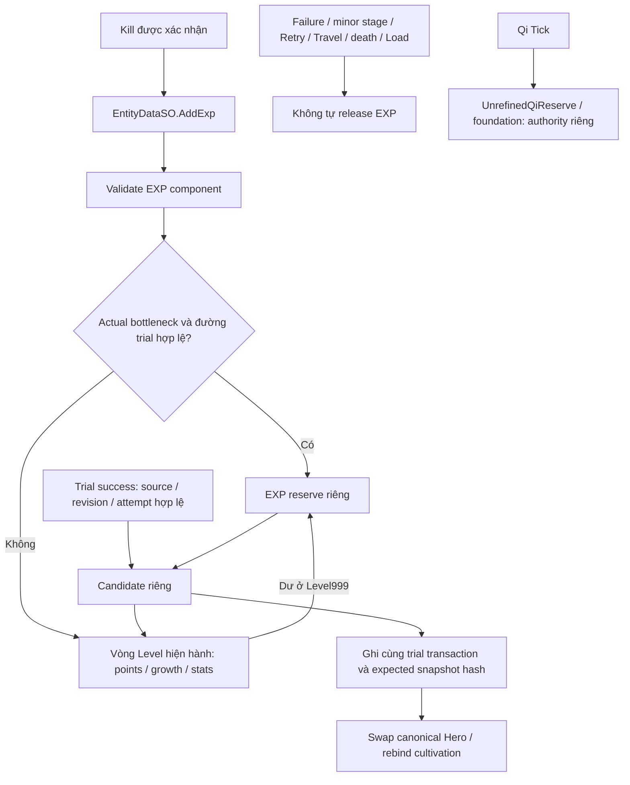

# EXP Bottleneck & Mastery Foundation — Cloud, 12/11/2026

<!-- daily-freeze-rc2 -->
> Lượt Daily Freeze xác nhận EXP bank và bảo toàn qua Load trên Windows. Release thành công và hợp đồng Mastery vẫn dựa trên kiểm thử domain. [Báo cáo Daily Freeze](DAILY_FREEZE_2026-11-12_FINAL_REPORT.md).

## Nền và quyết định đã chốt

Nhánh `feature/cloud-exp-bottleneck-mastery` dựa trên PR #19,
`feature/cloud-dual-progression-audit` tại
`2b88eb59c0c0d2c5c1620a0ffd2fd9191bdbcefd`. PR mới nhắm vào nhánh này,
không nhắm development/main và không chứa lại diff PR #19. Đã fetch toàn bộ
origin, rà PR đang mở và đọc AGENTS, skill dự án/Unity/Save, báo cáo PR #19,
tài liệu Dual Progression/Cultivation/Combat và các đường gọi liên quan.
Nền giữ đầy đủ DEV trial/cultivation và hai sửa lỗi codec của PR #19, không cần
phụ thuộc truyện, animation, Weather hoặc Item Catalog ở các PR khác.
Không merge/cherry-pick/rebase PR nào.

Người dùng xác nhận trong phiên: **“Chỉ bật EXP bank khi có successor và đường
breakthrough hợp lệ; cap cuối vẫn tăng Level.”** Vì thế production hiện chỉ
Luyện Khí, successor rỗng, vẫn tăng Level. DEV/fixture có trial hợp lệ sẽ bank
ở cap của realm nguồn; realm cuối của DEV vẫn tăng Level. Không hardcode Level45,
tên realm hoặc ngưỡng mới. Injury/pause/death tạm thời không xóa đường đột phá;
bank không bị tắt bởi việc Hero chưa thể bấm trial ngay lúc đó.

## Audit và luồng trước/sau

Trước sửa: kill có lethal/loot receipt hợp lệ → `EntityDataSO.AddExp` → Level,
currentExp, statPoints, một random growth 50..100 mỗi Level. AddExp không đọc
actual cultivation. Level999 clamp currentExp và mất phần dư. Các grant ngoài
Combat là Editor/probe/test; chúng vẫn đi qua AddExp. Trial combat không cấp
kill EXP/loot. Qi Tick không gọi AddExp.

Bốn vòng ép Level/points trong `MainGameFoundationProbe` trước đây bỏ qua kết
quả AddExp. Nay chúng Require phải tăng Level và dừng rõ nếu award bị bank/cap/
reject, tránh vòng vô hạn. Không bypass gate hoặc làm yếu assertion của probe.

Bank cần actual `AtBottleneck`, profile hỗ trợ runtime trial, config gate hợp
lệ và đúng profile/source/successor, target tồn tại và tăng combat tier.
Không dùng `CanAttemptBreakthrough` làm công tắc bank vì injury tạm thời có thể
làm hàm này từ chối trial. GameManager truyền đúng TrialConfiguration vào binding
canonical; gate là dữ liệu dẫn xuất, không lưu boolean dễ cũ trong Save.

Release chỉ trong candidate của `PrepareTrialResult` khi success. API kiểm tra
component/revision/actual source snapshot/attempt, rồi gọi RealmBreakthroughTransition
hiện có và áp bank qua cùng vòng Level. Failure chỉ áp penalty như trước. Nếu
failure làm foundation xuống dưới cap, EXP mới lại lên Level bình thường; bank
cũ vẫn giữ đến major success. Minor stage không release. Không đổi Qi/balance.

Một attempt đã áp được lưu cùng realm nhận. Duplicate bị từ chối trước Level;
source JSON cũ không thể tiêu bank của candidate mới. Trial commit giữ nguyên
candidate đã chuẩn bị khi retry write, không roll growth lại. Snapshot hash và
receipt hiện có tiếp tục bảo vệ durable commit. Candidate lỗi bị hủy trước khi
được công bố để Retry. Gameplay/durable crash behavior vẫn cần Unity nghiệm thu.

## Save component và tương thích

Thêm root field chuỗi `experienceJson`, độc lập với cultivationJson và
UnrefinedQiReserve. Component v1 có bốn field bắt buộc:

| Field | Kiểu / ý nghĩa |
| --- | --- |
| version | Integer1; future version bị từ chối |
| reserve | Chuỗi decimal nguyên không âm, canonical, dùng BigInteger khi tính |
| lastReleaseAttempt | GUID N hoặc chuỗi rỗng khi chưa release |
| lastReleaseRealm | Target realm của receipt, rỗng cùng attempt |

Legacy thiếu root field hoặc chuỗi rỗng → zero reserve, không di chuyển currentExp.
Load reset từ root đã validate, không thừa kế template. Root null/sai kiểu,
partial/negative/noncanonical/unknown field/future component bị từ chối trước
FromJsonOverwrite. SaveGame, normal writer, existing-slot guard và trial candidate
đều kiểm tra component. Migration cultivation dùng TryLoadSnapshot nên nhận cùng
guard; các token root khác vẫn được cơ chế upgrade cũ bảo toàn.

Kiểm tra component thuần dữ liệu đã chạy; SaveManager/migration được đối chiếu
mã và compile, chưa chạy native/I/O. Explicit null ở entity cũng bị từ chối để
trial candidate không thể ghi payload mà Load sau đó từ chối. Build cũ trước
task chưa biết field này có thể bỏ nó khi Save lại; tính tương thích đã kiểm
tra là dữ liệu cũ vào build mới, chưa chứng nhận downgrade client.

BigInteger chỉ là bảo toàn số nguyên, không đặt cap/rate cân bằng. Khi chạm
Level999, currentExp giữ giới hạn cũ và phần không thể tiêu còn trong reserve;
không cấp points/growth thêm, không vứt phần dư. Sau terminal realm Level vẫn
tăng đến giới hạn Level hiện có. Reserve còn ở Level999 chưa có chính sách tiêu
khác; task này chỉ bảo toàn. Không đụng save người chơi hoặc chạy Save I/O.

## Mastery đã có và chưa bật

Audit: family lấy từ template của vũ khí đang equipped, không từ stance/class.
Ba skill hiện có mang ID `combat:kiem-dam`, `combat:lien-hoan-tien`,
`combat:hoa-cau-thuat`; cả ba là EquipmentGranted, Common không cấp skill.
Learned/queue/cooldown có cấu trúc riêng nhưng không phải Mastery; thêm ID learned
không tự tạo quyền sở hữu skill trang bị.

Đã thêm DTO version1 cho records weapon/skill, stable weapon-family keys, validator
ID/duplicate/nonnegative và receipt execution theo owner/epoch/life/spawn/battle/
sequence. Hook tối thiểu ở basic release và skill release đã commit, trước effect;
volley/projectile/hit/damage/kill callbacks không tự tạo execution mới. Hook chỉ
primary Hero dùng weapon basic thực, không suy ra vũ khí từ companion fallback.
Không kiểm tra bottleneck để chặn evidence; swap/context cũ bị từ chối.

**Chưa bật Mastery award/progression, level/cap/rate/bonus hoặc player Save field.**
DTO hiện là hợp đồng cho policy sau, không phải tiến trình đang tăng. Evidence
chỉ chứng minh execution tại điểm hook, không khẳng định hit/damage/kill. Policy
award theo cast/hit/kill, lượng tăng, giới hạn và hỗ trợ companion chưa được chốt;
không tự chọn. DTO roundtrip không phải player Save/Load Mastery PASS.

## Kết quả Cloud cuối

- Trước sửa: chạy AddExp thật trên nền → **29 PASS / 2 FAIL**. Characterization
  xác nhận actual cap không được AddExp xét (Level1→2); ở Level999, +100 bị clamp
  mất. Ca trước sửa chưa có API gate/reserve; ca sau sửa dùng binding với profile
  successor và trial config thật của fixture để xác minh integration mới.
  Có thể tái chạy nguyên mã nền bằng `Tests~/ExpBottleneckMastery/baseline.sh`:
  git archive tạm, không đổi working tree; expected exit1 với hai FAIL trên.
- Sau sửa: **50 PASS / 0 FAIL** qua `Tests~/ExpBottleneckMastery/run.sh`: 29 nhóm
  PR #19 cùng 21 nhóm EXP/Mastery. Normal/bank/Qi separation, terminal/no-path,
  minor/success/failure/duplicate/stale, multi-level points/growth, cap999/huge
  integer, component current/legacy/future/invalid, binding lifecycle và receipts.
- **PASS standalone compilation** Roslyn với DLL Unity6000.5.0f1: 0 errors,
  92 warnings, bằng baseline. Không phải Unity import hoặc Player build.
- **PASS GUID checker**: 0 errors, 64 warnings; nền62 cộng hai script mới chưa
  có .meta. Không tạo GUID giả; cần Unity import và commit metadata tại máy nhà.
- **PASS** shell syntax, `git diff --check`; runner PR #19 riêng vẫn29 PASS.
- **BLOCKED** runner Mono tổng: đúng12 lỗi có sẵn về Vector2/Mathf/TMP và hai
  tham chiếu HeroHealthMultiplier cũ. Đã thêm source/reference mới vào runner,
  không sửa stub hoặc assertion ngoài phạm vi và không chạy tới Save I/O.
- **NOT TESTED:** Unity Edit/Play Mode, native JsonUtility/SaveManager roundtrip,
  fault/crash transaction, gameplay Retry/Travel/death, actual combat hooks và
  Windows Player. Data lifecycle/serialization PASS không thay thế các mục này.
- Mastery progression: **NOT IMPLEMENTED / POLICY PENDING**, không báo PASS.

## Rủi ro và nghiệm thu tại máy nhà

PR #19 là dependency; phải giữ target nhánh này, kiểm lại diff khi retarget sau
khi PR #19 được xử lý. GitHub báo mergeable với đúng nhánh nền tại checkpoint.
So file với development_0.1.7 chung, không merge thử:

| PR / head đã kiểm tra | File trùng với task này |
| --- | --- |
| #12 `5d41014` | Không có |
| #13 `5915829`, #17 `cc27145` | EntityDataSO, CombatManager, SaveManager, MainGameFoundationProbe, Tests~/run.sh |
| #16 `c00dae6` | EntityDataSO, SaveManager, MainGameFoundationProbe |
| #18 `9349f5f` | Không có |

Đây là file overlap, chưa kết luận conflict hunk hoặc nghiệm thu kết hợp.
Không sửa truyện/Weather/animation/Inventory và không merge PR nào.

Checklist Unity (fixture có đường dẫn riêng trước Awake, marker/quyền sở hữu):

- [ ] Import hai script, tạo metadata bằng Unity; compile toàn project.
- [ ] Windows MainGame DEV LK cap bank EXP, ordinary kills không tăng Level;
  success tăng nhiều Level đúng HP/points/growth và còn nguyên Qi; Trúc Cơ cap
  tiếp tục Level bình thường. Production LK cap tiếp tục Level bình thường.
- [ ] Failure/simultaneous KO/duplicate callback/stale Hero không release;
  re-attain cap và success sau failure tiêu đúng bank một lần.
- [ ] Fault trước/sau replace, Retry commit, thoát/relaunch active hoặc terminal
  checkpoint: không lặp growth/points hoặc mất bank, snapshot mới hơn được giữ.
- [ ] Native Save/Load slot current, legacy thiếu field, future/invalid component;
  template có reserve không rò vào legacy, rejected load giữ canonical cũ.
- [ ] Retry/Travel/death/Load/pause không tự grant; basic/skill release đúng family,
  swap lúc windup, canceled cast, volley multi-hit chỉ có evidence phù hợp.
- [ ] Max Level với reserve rất lớn; không overflow, âm hoặc roll growth lại.

## Checkpoint và bằng chứng

- `029d4ad`: EXP runtime/component, Mastery contract/hooks, 50 nhóm và báo cáo;
  push rồi mở [Draft PR #20](https://github.com/lavievn/IdleGame/pull/20), target PR #19.
- `67ae8f8`: baseline tái chạy được, guard probe loops, mở rộng invalid/overflow
  assertions và bằng chứng compile/runner/overlap; đã push.
- `3146c58`: từ chối explicit null EXP trước candidate commit; 50 PASS và
  standalone0 errors/92 warnings sau sửa; đã push.
- Commit tài liệu cuối bổ sung kết quả, giới hạn và checklist; không đổi runtime.

[Before:29 PASS/2 FAIL](evidence/exp-bottleneck-mastery/before.txt) ·
[After:50 PASS/0 FAIL](evidence/exp-bottleneck-mastery/data-tests.txt) ·
[Validation](evidence/exp-bottleneck-mastery/validation.txt) ·
[Runner tổng BLOCKED](evidence/exp-bottleneck-mastery/full-runner-blocked.txt) ·
[Branch overlap và SHA](evidence/exp-bottleneck-mastery/branch-overlap.json).
