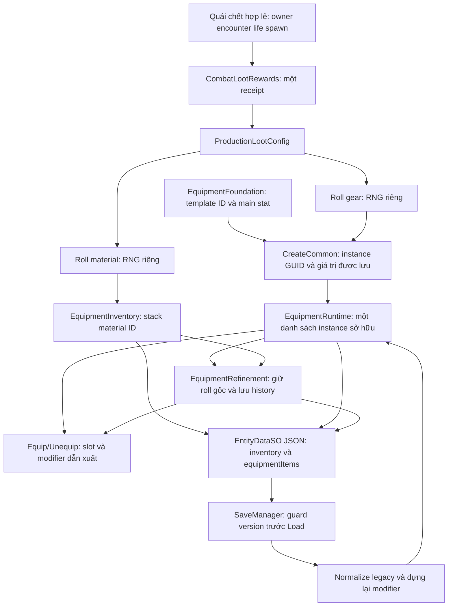

# Item Catalog & Loot Foundation — Cloud, 12/11/2026

## Nhánh nền và checkpoint

Nhánh: `feature/cloud-item-loot-foundation`, tách trực tiếp từ
`development_0.1.7` tại `fafc02d613a2e6a15c72a8dd48b935d2faa54f0e`.
Đã fetch toàn bộ origin, working tree ban đầu sạch. Đã đọc `AGENTS.md`, skill
dự án/Unity/Save, định hướng core loop, schema trang bị, tài liệu Inventory,
Compare, Forge, affix, loot/VFX và các báo cáo production v0.1, gear drop, 0.1.7.

| Nhánh/PR đã đối chiếu | Kết luận chọn nền |
| --- | --- |
| `main` (`a774218`) | Thiếu ProductionLootConfig hai stream, các chỉnh sửa trang bị/Compare và Save mới; không dùng. |
| `development_0.1.7` (`fafc02d`) | Có catalog/instance/Forge/loot hai stream, gear prototype, skill grants và modifier/Compare đã cập nhật. Có báo cáo nghiệm thu Unity/Windows lịch sử. Chọn làm nền ít phụ thuộc. |
| PR #12, `development_0.1.8-cloud` (`5d41014`) | File catalog, runtime, inventory, refinement, loot và Save trùng 0.1.7; thêm animation, không cần làm phụ thuộc. |
| PR #13, truyện (`5915829`) | Item/Loot/Forge trùng nền; Save/Entity thêm origin. Không cần kéo cốt truyện vào nhiệm vụ dữ liệu. |
| PR #16, Weather (`c00dae6`) | Item/Loot/Forge trùng nền; Save/Entity thêm climate. Không cần kéo Weather/Sky/Audio vào nhiệm vụ. |
| PR #17, Cloud Hàn Vụ (`cc27145`) | Giữ cùng hệ Item/Loot/Forge, chỉ thêm polish truyện/HUD/test. Không cần làm phụ thuộc. |

Bốn PR đều đang Draft/open khi kiểm tra. Không merge hoặc cherry-pick. So sánh
toàn luồng và lịch sử xác nhận không bỏ sót thay đổi Item quan trọng chỉ có ở
các nhánh mới hơn. Kết quả Unity/Windows trong tài liệu nền là lịch sử, không
phải kết quả của phiên Cloud này.

## Luồng dữ liệu đã truy vết

VFX chỉ trình bày món đã cấp; không cấp lại khi bay xong. Receipt là runtime,
không phải ledger chống replay qua crash/Load. Travel/Retry vô hiệu hóa encounter
qua đường hiện có; nhiệm vụ này chỉ kiểm tra API dữ liệu, không chạy gameplay.

## Audit tính năng hiện tại

| Hạng mục | Đã có | Cấu trúc/placeholder hoặc chưa có | Rủi ro/ghi chú |
| --- | --- | --- | --- |
| Catalog | 13 EquipmentTemplate ID ổn định, hai hộ phù legacy và ID nguyên liệu rèn; factory/lookup | Catalog equipment nằm trong code, chưa có asset catalog chung hoặc import pipeline | Tài liệu 0.0.52 có đoạn cũ hơn mã hiện tại; không coi chúng là authority runtime. |
| Vũ khí và ô | Unarmed/Sword/Bow/Staff; tám slot, nhẫn dùng hai vị trí với hai instance | Chưa có mọi archetype vũ khí/armor production | Không có class; kỹ năng xét family/source/tài nguyên, không xét class. |
| Chỉ số | Main/extra riêng, flat/percent/element/tag; Physical Attack ID 1 khác MagicalAttack ID 15 | Range theo cấp/phẩm/realm và generator affix production chưa chốt | Common chỉ áp main; roll phụ lưu nguyên, không reroll khi Load. |
| HP | Modifier dẫn xuất; đổi/tháo không ghi vào baseHealth hoặc meleeGrowthBonus | HP% vũ khí không phải luật chính thức | Không thay công thức HP/combat; kiểm tra cả ba họ vũ khí. |
| Rarity/level | Sáu phẩm, level 1..999, refine 0..100, affix Hidden/KnownLocked/Active | Xác suất hiếm toàn bộ và yêu cầu Hero level/realm để mặc chưa có | Không tự thêm điều kiện trang bị theo class/cấp. Hai hằng Thiên/Tiên không chạy thành loot table. |
| Loot | Hai RNG độc lập, outcome/error riêng, receipt một lần, stale/pool guards | Chưa có bảng loot riêng theo loài/rank/map hoặc quy tắc rare production | Một nhánh lỗi giữ kết quả hợp lệ của nhánh còn lại, không reroll. |
| Inventory | Stack và instance riêng, deep copy, ID chống trùng, equip/unequip tám slot | Giới hạn ô chứa/economy production chưa chốt | Unknown template được giữ opaque khi normalize và tháo bonus; không xóa món. |
| Forge | Normal/Special/+level và đường giảm prototype; giữ raw stats, lịch sử và vật liệu | Nghề, recipe, gold cost, failure/destruction mới có schema | Các ngưỡng 3/6/12/24/48 và cost 1/10 là prototype đã có. |
| Save | Component versions; guard toàn kho/history, candidate load, normalize và modifiers | Chưa có transaction ledger item qua crash | Không đổi schema trong task. Serialization thuần dữ liệu không chứng minh SaveManager/gameplay. |
| ScriptableObject | EntityDataSO chứa instance/stack; config loot serializable trong GameManager/scene | Không tìm thấy ItemTemplateSO/MonsterLootTableSO đang làm authority | Không tạo SO/asset/GUID giả hoặc hệ catalog song song. |

## Cấu hình được bảo toàn

MainGame đang dùng `configured=true`, `controlledLootTest=false`:

- Material enabled, chance **0,60**, `material:refinement`, lượng **1–2**.
- Gear enabled, chance **0,08**, Uniform giữa `sample:iron_sword` và
  `sample:basic_bow`, level **1**, main Physical Attack **+4**, Common.
- Staff và đồ phòng thủ có template/dev grant nhưng không được thêm vào loot.

Đây là prototype đã được duyệt trong tài liệu core loop/gear drop/0.1.7; không
phải balance production cuối. TODO thiết kế: stat ranges, tier scaling,
rarity odds, giá/gold economy, yêu cầu level/realm, bảng riêng cho monster/map,
affix generation production, nghề/recipe/failure. Không gán giá trị mới.

## Checkpoint đầu: kiểm thử và lỗi đã tái hiện

Runner mới `Tests~/ItemLootFoundation/run.sh` biên dịch các lớp production
Item/Loot/Inventory/Forge/stat thật với UnityStub có sẵn, không chạy SaveManager
hoặc save I/O. Một adapter môi trường chỉ phục vụ signature không liên quan và
ném lỗi nếu bị gọi; không thay factory, loot service hoặc Forge bằng mock.

- **PASS 9 nhóm**: catalog/factory/slots; bốn outcome độc lập; seeded streams;
  invalid template/overflow; stale receipt; loot → Inventory → Forge → JSON
  trong bộ nhớ; Physical/Magical và HP; legacy/missing template; deep copy/ID.
- **FAIL 1 regression xác nhận**: `EquipmentFoundation.IsValid` chấp nhận item
  có `forgeSchemaVersion` hoặc `forgeHistory.checkpointVersion` tương lai. Item
  có thể đi qua AddInstance/Forge dù SaveManager sẽ từ chối version đó. Bản sửa
  đang chờ checkpoint tiếp; không đổi schema để xử lý lỗi này.
- Lượt fixture đầu có hai lỗi kỳ vọng test: ghi Attack thành enum 0 (đúng là 1)
  và so nguyên metadata affix v0 sau normalize lên v1. Đã đối chiếu mã, sửa
  fixture, vẫn kiểm tra nguyên ID/roll/Forge history và tính idempotent.
- Unity Editor/Play Mode, Windows Player, SaveManager round trip, UI, Retry và
  Travel gameplay: **NOT TESTED** trong Cloud. Cần fixture cô lập trên máy nhà.

Các mục bản sửa, kiểm thử cuối, commit, xung đột và checklist nghiệm thu sẽ được
cập nhật ở checkpoint tiếp theo trong cùng Draft PR.
