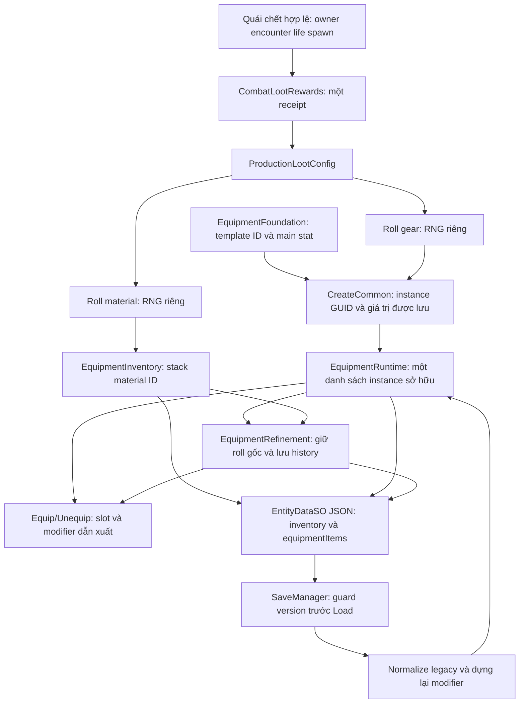

# Item Catalog & Loot Foundation — Cloud, 12/11/2026

<!-- daily-freeze-rc2 -->
> Lượt Daily Freeze xác nhận 19 nhóm domain và chạy Windows Development017 trên artifact tích hợp. [Báo cáo Daily Freeze](DAILY_FREEZE_2026-11-12_FINAL_REPORT.md).


## Nhánh nền và checkpoint

Nhánh: `feature/cloud-item-loot-foundation`, tách trực tiếp từ
`development_0.1.7` tại `fafc02d613a2e6a15c72a8dd48b935d2faa54f0e`.
Đã fetch toàn bộ origin, working tree ban đầu sạch. Đã đọc `AGENTS.md`, skill
dự án/Unity/Save, định hướng core loop, schema trang bị, tài liệu Inventory,
Compare, Forge, affix, loot/VFX và các báo cáo production v0.1, gear drop, 0.1.7.

| Nhánh/PR đã đối chiếu | Kết luận chọn nền |
| --- | --- |
| `main` (`a774218`) | Thiếu ProductionLootConfig hai stream, các chỉnh sửa trang bị/Compare và Save mới; không dùng. |
| `development_0.1.7` (`fafc02d`) | Có catalog/instance/Forge/loot hai stream, gear prototype, skill grants và modifier/Compare đã cập nhật. Có báo cáo nghiệm thu Unity/Windows lịch sử. Chọn làm nền ít phụ thuộc. |
| PR #12, `development_0.1.8-cloud` (`5d41014`) | File catalog, runtime, inventory, refinement, loot và Save trùng 0.1.7; thêm animation, không cần làm phụ thuộc. |
| PR #13, truyện (`5915829`) | Item/Loot/Forge trùng nền; Save/Entity thêm origin. Không cần kéo cốt truyện vào nhiệm vụ dữ liệu. |
| PR #16, Weather (`c00dae6`) | Item/Loot/Forge trùng nền; Save/Entity thêm climate. Không cần kéo Weather/Sky/Audio vào nhiệm vụ. |
| PR #17, Cloud Hàn Vụ (`cc27145`) | Giữ cùng hệ Item/Loot/Forge, chỉ thêm polish truyện/HUD/test. Không cần làm phụ thuộc. |

Bốn PR đều đang Draft/open khi kiểm tra. Không merge hoặc cherry-pick. So sánh
toàn luồng và lịch sử xác nhận không bỏ sót thay đổi Item quan trọng chỉ có ở
các nhánh mới hơn. Kết quả Unity/Windows trong tài liệu nền là lịch sử, không
phải kết quả của phiên Cloud này.

## Luồng dữ liệu đã truy vết



VFX chỉ trình bày món đã cấp; không cấp lại khi bay xong. Receipt là runtime,
không phải ledger chống replay qua crash/Load. Travel/Retry vô hiệu hóa encounter
qua đường hiện có; nhiệm vụ này chỉ kiểm tra API dữ liệu, không chạy gameplay.

## Audit tính năng hiện tại

| Hạng mục | Đã có | Cấu trúc/placeholder hoặc chưa có | Rủi ro/ghi chú |
| --- | --- | --- | --- |
| Catalog | 13 EquipmentTemplate ID ổn định, hai hộ phù legacy và ID nguyên liệu rèn; factory/lookup; nay có view chỉ đọc và validator cấu trúc | Catalog equipment nằm trong code, chưa có asset catalog chung hoặc import pipeline | Hai catalog equipment/legacy vẫn tách theo hợp đồng đã có; ID được kiểm tra không trùng. Tài liệu 0.0.52 có đoạn cũ hơn mã hiện tại. |
| Vũ khí và ô | Unarmed/Sword/Bow/Staff; tám slot, nhẫn dùng hai vị trí với hai instance | Chưa có mọi archetype vũ khí/armor production | Không có class; kỹ năng xét family/source/tài nguyên, không xét class. |
| Chỉ số | Main/extra riêng, flat/percent/element/tag; Physical Attack ID 1 khác MagicalAttack ID 15 | Range theo cấp/phẩm/realm và generator affix production chưa chốt | Common chỉ áp main; roll phụ lưu nguyên, không reroll khi Load. |
| HP | Modifier dẫn xuất; đổi/tháo không ghi vào baseHealth hoặc meleeGrowthBonus | HP% vũ khí không phải luật chính thức | Không thay công thức HP/combat; kiểm tra cả ba họ vũ khí. |
| Rarity/level | Sáu phẩm, level 1..999, refine 0..100, affix Hidden/KnownLocked/Active | Xác suất hiếm toàn bộ và yêu cầu Hero level/realm để mặc chưa có | Không tự thêm điều kiện trang bị theo class/cấp. Hai hằng Thiên/Tiên không chạy thành loot table. |
| Loot | Hai RNG độc lập, outcome/error riêng, receipt một lần, stale/pool guards | Chưa có bảng loot riêng theo loài/rank/map hoặc quy tắc rare production | Một nhánh lỗi giữ kết quả hợp lệ của nhánh còn lại, không reroll. |
| Inventory | Stack và instance riêng, deep copy, ID chống trùng, equip/unequip tám slot | Giới hạn ô chứa/economy production chưa chốt | Unknown template được giữ opaque khi normalize và tháo bonus; không xóa món. |
| Forge | Normal/Special/+level và đường giảm prototype; giữ raw stats, lịch sử và vật liệu | Nghề, recipe, gold cost, failure/destruction mới có schema | Các ngưỡng 3/6/12/24/48 và cost 1/10 là prototype đã có. |
| Save | Component versions; guard toàn kho/history, candidate load, normalize và modifiers | Chưa có transaction ledger item qua crash | Không đổi schema trong task. Serialization thuần dữ liệu không chứng minh SaveManager/gameplay. |
| ScriptableObject | EntityDataSO chứa instance/stack; config loot serializable trong GameManager/scene | Không tìm thấy ItemTemplateSO/MonsterLootTableSO đang làm authority | Không tạo SO/asset/GUID giả hoặc hệ catalog song song. |

## Cấu hình được bảo toàn

MainGame đang dùng `configured=true`, `controlledLootTest=false`:

- Material enabled, chance **0,60**, `material:refinement`, lượng **1–2**.
- Gear enabled, chance **0,08**, Uniform giữa `sample:iron_sword` và
  `sample:basic_bow`, level **1**, main Physical Attack **+4**, Common.
- Staff và đồ phòng thủ có template/dev grant nhưng không được thêm vào loot.

Đây là prototype đã được duyệt trong tài liệu core loop/gear drop/0.1.7; không
phải balance production cuối. TODO thiết kế: stat ranges, tier scaling,
rarity odds, giá/gold economy, yêu cầu level/realm, bảng riêng cho monster/map,
affix generation production, nghề/recipe/failure. Không gán giá trị mới.

## Lỗi xác nhận và bản sửa

Runner mới `Tests~/ItemLootFoundation/run.sh` biên dịch các lớp production
Item/Loot/Inventory/Forge/stat thật với UnityStub có sẵn, không chạy SaveManager
hoặc save I/O. Một adapter môi trường chỉ phục vụ signature không liên quan và
ném lỗi nếu bị gọi; không thay factory, loot service hoặc Forge bằng mock.

- **PASS 9 nhóm**: catalog/factory/slots; bốn outcome độc lập; seeded streams;
  invalid template/overflow; stale receipt; loot → Inventory → Forge → JSON
  trong bộ nhớ; Physical/Magical và HP; legacy/missing template; deep copy/ID.
- **FAIL 1 regression trước sửa**: `EquipmentFoundation.IsValid` chấp nhận item
  có `forgeSchemaVersion` hoặc `forgeHistory.checkpointVersion` tương lai. Item
  đi qua AddInstance/Forge dù guard của SaveManager từ chối version đó. Probe
  độc lập chạy đúng mã nền `fafc02d` xác nhận cả hai trường hợp: AddInstance
  trả true, SpecialUp trả true, vật liệu từ 20 xuống 10, SupportsSaveVersions
  trả false. Không tạo SaveManager hoặc ghi save để chứng minh lỗi.
- **Bản sửa**: `IsValid` gọi guard `SupportsItemVersions` trước kiểm tra nội
  dung. Các API nhận đồ/equip/preview/Forge vốn dùng IsValid nay cùng từ chối
  dữ liệu không hỗ trợ; không sửa riêng từng callsite hoặc đổi version Save.
  Regression sau sửa kiểm tra không đổi item/history/dirty flag/tồn kho.
- **Lỗi ID trắng**: mã nền coi instanceId toàn khoảng trắng là hợp lệ. Nay từ
  chối null/rỗng/toàn khoảng trắng; ID legacy không phải GUID vẫn giữ nguyên,
  không tự cấp ID thay thế. Unknown template vẫn được giữ opaque theo luồng cũ.
- **Catalog**: bổ sung `EquipmentFoundation.Templates` chỉ đọc trên chính
  bảng hiện có và `TryValidateCatalog`. Validator kiểm ID/name, trùng ID,
  enum slot/stat/family, metadata hữu hạn và skill tham chiếu/tương thích family.
  Không thêm bảng catalog song song, template, stat range hoặc balance. API
  phục vụ kiểm thử/công cụ; kiểm tra config loot lúc roll vẫn dùng đường cũ.
- Lượt fixture đầu có hai lỗi kỳ vọng test: ghi Attack thành enum 0 (đúng là 1)
  và so nguyên metadata affix v0 sau normalize lên v1. Đã đối chiếu mã, sửa
  fixture, vẫn kiểm tra nguyên ID/roll/Forge history và tính idempotent.

## Kết quả kiểm thử cuối

| Kiểm tra | Kết quả | Giới hạn |
| --- | --- | --- |
| Runner thuần dữ liệu | **PASS 19/19 nhóm** | Mono/UnityStub; không SaveManager/save I/O. |
| Catalog/identity | **PASS** | Tất cả template, tám slot, ID không trùng giữa gear/charm/material, view chỉ đọc, bad enum/skill/ID; không phải asset importer. |
| Loot independence/lifecycle | **PASS** | Bốn outcome, stream seed tái lập, đổi quantity/tắt peer, callback trùng, ID trùng do factory, map context stale, invalidate và lỗi từng nhánh. RNG/receipt/factory/Inventory production được chạy thật trong runner dữ liệu. |
| Equipment/Forge/legacy | **PASS** | Tám slot, swap/tháo, Artifact/charm legacy, Physical/Magical, HP không ghi vĩnh viễn, Compare khớp modifier đã Forge, vật liệu/history, thiếu trường/template, version tương lai và deep copy. |
| In-memory serialization | **PASS, UnityStub** | Giữ ID/roll/history/stock/equip, normalize idempotent. Không chứng minh Unity JsonUtility, file Save/Load hoặc gameplay Save/Load. |
| Standalone Roslyn runtime compile | **PASS**, 0 lỗi / 92 cảnh báo | Cùng DLL Unity **6000.5.0f1**, UI/TMP/InputSystem có sẵn trong bản cài Cloud; baseline `fafc02d` cũng 0 lỗi / 92 cảnh báo. Không phải Editor import/build. |
| `Tests~/run.sh --production-rewards` | **BLOCKED**, 12 lỗi có sẵn | 10 API UnityStub thiếu và 2 test HP legacy tham chiếu HeroHealthMultiplier. Các file gây lỗi không đổi so với nền; không sửa Combat/test ngoài phạm vi để ép PASS. |
| GUID/.meta checker | **PASS**, 0 lỗi / 62 cảnh báo | Thiếu PackageCache nên các tham chiếu package còn chưa xác nhận. Không thêm asset hoặc GUID. |
| Shell syntax, `git diff --check` | **PASS** | Không có lỗi cú pháp script/whitespace. |
| Unity Editor/Edit/Play Mode, Unity serialization | **NOT TESTED** | Không mở Editor hoặc chạy fixture native trong phiên này. |
| SaveManager, Retry/Travel gameplay, native Inventory/Forge UI | **NOT TESTED** | Chỉ truy vết mã và kiểm API dữ liệu. Không báo gameplay PASS. |
| Windows build/Player, full progression/balance | **NOT TESTED** | Không dùng kết quả lịch sử làm bằng chứng cho nhánh mới. |

[Kết quả 19 nhóm](evidence/item-loot-foundation/data-tests.txt),
[baseline regression](evidence/item-loot-foundation/baseline-tests.txt),
[probe lỗi phiên bản trên mã nền](evidence/item-loot-foundation/baseline-version-probe.txt),
[tổng hợp compile/checker](evidence/item-loot-foundation/validation-summary.txt) và
[12 lỗi runner tổng](evidence/item-loot-foundation/full-runner-errors.txt).

### Tái chạy

```bash
bash Tests~/ItemLootFoundation/run.sh
# Compiler C# 7.2+ và Mono có sẵn hoặc wrapper, không cần Editor:
CSC=/path/to/csharp-compiler-wrapper MONO=/path/to/mono bash Tests~/ItemLootFoundation/run.sh
python3 .agents/skills/unity-csharp-scripting/scripts/check_unity_project.py . --json
bash -n Tests~/ItemLootFoundation/run.sh
git diff --check
```

Phiên Cloud dùng Roslyn `csc.exe` và Mono có sẵn trong
`.onboarding/unity/6000.5.0f1/Editor/Data/MonoBleedingEdge`. Không cài dependency,
không cần cache asset hoặc save máy nhà. Test số lượng/tỷ lệ đều là fixture và
không ghi đè MainGame. Runner cùng mã production được biên dịch lại mỗi lần.

## Checkpoint, phạm vi và xung đột

- `3834f7a`: audit ban đầu, runner và regression tái hiện lỗi trước sửa; đã push
  và tạo [Draft PR #18](https://github.com/lavievn/IdleGame/pull/18).
- `70454f0`: catalog view/validator, chặn version/ID không hợp lệ, 19 nhóm
  regression và README tái chạy. **Chỉ đổi một file production**:
  `Assets/Script/EquipmentFoundation.cs`.
- Checkpoint sau cùng cập nhật báo cáo và lưu bằng chứng. PR giữ Draft;
  nhắm vào `development_0.1.7`, không phụ thuộc PR #12/#13/#16/#17.
- Khi kiểm tra, bốn nhánh PR không thay `EquipmentFoundation.cs` so với nền;
  chưa thấy file production trùng với diff mới. Thay đổi catalog/validator
  tương lai ở file này có thể cần tích hợp thủ công; chưa merge thử các PR.
- Không sửa Weather/Time/Audio/HDR/Rain, truyện, HUD/animation/camera,
  Combat balance, Cultivation, scene, loot config, schema hoặc SaveManager.
  Không đổi công thức Forge, giá, odds, stat roll hoặc yêu cầu trang bị.
- Kiểm tra remote HEAD bằng `git ls-remote --heads origin
  feature/cloud-item-loot-foundation` và so với `git rev-parse HEAD` sau push.

## Nghiệm thu trên máy nhà

1. Dùng fixture Save cô lập theo `AGENTS.md`, không dùng save thật. Chạy native
   EquipmentVersionGuardTests và các ca JSON/normalization/CombatLootTests.
2. MainGame nhận gear/material từ death flow thật, xác nhận một receipt/kill;
   hai nhóm có thể cùng rơi hoặc cùng không rơi, không phát đồ qua VFX lần nữa.
3. Nhận item → Inventory → Equip/Unequip/Swap → Forge thường/đặc biệt → Manual
   Save/Load: giữ đúng ID/raw roll/effective stat/history/stock; thử save legacy
   thiếu trường và template không còn trong catalog.
4. Retry/Travel/Load khi loot VFX đang sống: không cấp lại receipt cũ; item đã
   cấp giữ theo checkpoint hiện hành. Không hứa chống farm lại qua crash bằng
   ledger mới vì task không thêm ledger hoặc đổi chính sách checkpoint.
5. Xác minh scene/Inspector vẫn giữ prototype 60% material và 8% Sword/Bow;
   gameplay HP, skill source và các slot không hồi quy. Chưa chốt balance cao
   hơn thì giữ TODO ở mục cấu hình, không tự mở loot Staff/armor/rare/gold.
6. Chạy Windows Player và tương tác Inventory/Forge thật trước khi bỏ Draft.
