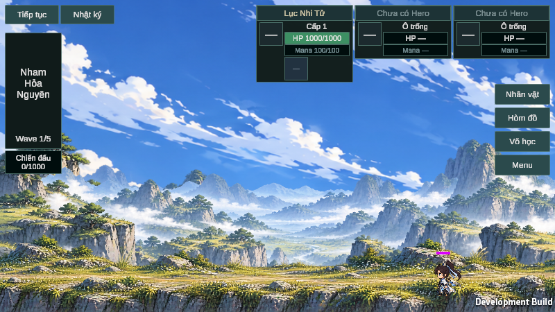
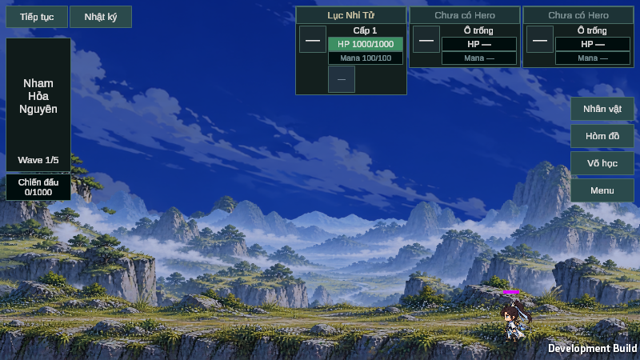

# Thử nghiệm ngày–đêm và thời tiết

[PR #16](https://github.com/lavievn/IdleGame/pull/16) · `feature/dynamic-sky-weather-cycle` · baseline `f695df96547c57296562cbd6f1b061d359933814`. Worktree thử nghiệm ở `D:/IdleGame/Projects/DynamicSkyWeather`.

## Phần chạy được

- Một ngày dài **780 giây hoạt động**, mỗi giờ trong game dài 32,5 giây. Game mới bắt đầu ngày 0 lúc 05:00. Các pha là bình minh 05:00–08:00, ban ngày 08:00–17:00, hoàng hôn 17:00–20:00 và ban đêm 20:00–05:00. Màu chuyển mượt trên các lớp nền. HUD, chữ và sprite nhân vật giữ màu hiển thị riêng.
- Đồng hồ dùng delta không scale khi gameplay đang chạy. Pause, màn hình tiêu đề, entry, màn hình thua, mất focus và Thiên Quan giữ nguyên thời gian. Editor batch được tính như phiên đang hoạt động để chạy fixture. Load tiếp tục từ snapshot, thời gian đóng game không được cộng.
- Một lượt thời tiết kéo dài 4 giờ trong game, tương đương 130 giây theo cấu hình mặc định. Seed, ngày, map và lượt xác định thời tiết. Trọng số khác nhau cho đồng bằng, rừng, cao nguyên/đồi núi, đầm lầy, sa mạc, vùng nước, vùng tuyết và thảo nguyên. Trời quang, nhiều mây, sương, mưa nhẹ và mưa lớn có các mức riêng, nội suy trong 8 giây. Các map trong danh sách indoor và Thiên Quan không dùng mưa. Catalog hiện tại chưa có cờ indoor, nên danh sách có thể cấu hình riêng trong Inspector.
- Save có một thành phần tùy chọn `worldClimate` v1, gồm seed, ngày và phần ngày. Trạng thái thời tiết và mức blend được tính lại từ các giá trị đó cùng map đang lưu. Save cũ dùng ngày 0 lúc 05:00 và seed tương thích cố định 780. Save có phiên bản khí hậu tương lai được từ chối trước khi áp vào nhân vật hoặc ghi đè qua luồng lưu hiện có.
- MainGame dùng URP Renderer2D và Battle Canvas Screen Space Overlay. Bản thử nghiệm dùng sky PNG hiện hữu với tint. Điểm gắn adapter nhận texture 2D đã chiếu, đặt sau lớp núi, cây, mặt đất và actor. PNG chỉ tắt khi có texture 2D hợp lệ để thay thế. Adapter nhận viewport BattleArea cho Rain Maker 2D, chỉ được gọi khi cường độ mưa lớn hơn 0 và được dừng khi trời quang hoặc tắt cờ.

Trong Inspector của GameManager, **World Day Seconds** chỉnh độ dài ngày. **World Climate Lighting**, **World Climate Hdr Sky** và **World Climate Rain 2D** bật/tắt riêng từng phần hiển thị. **Preview World Climate** cho phép chọn giờ và thời tiết trong Editor hoặc Development Build qua cấu hình Inspector. Preview chỉ ảnh hưởng hiển thị, còn snapshot giữ đồng hồ thật.

## Asset Store

| Gói | Kết quả |
| --- | --- |
| BG Studio, Free HDR Skyboxes Pack 1.0 | **BLOCKED — ASSET IMPORT**. Không thấy file gói hoặc texture HDR của gói trong các thư mục đã kiểm tra. [Unity Asset Store](https://assetstore.unity.com/packages/2d/textures-materials/sky/free-hdr-skyboxes-pack-175525) |
| Digital Ruby, Rain Maker 2D and 3D Rain Particle System 2.1.2 | **BLOCKED — ASSET IMPORT**. Không thấy file gói, script hoặc prefab Rain Maker trong các thư mục đã kiểm tra. [Unity Asset Store](https://assetstore.unity.com/packages/vfx/particles/environment/rain-maker-2d-and-3d-rain-particle-system-for-unity-34938) |

Đã kiểm tra Asset Store cache mặc định dưới `%APPDATA%/Unity`, cache Unity cục bộ, `D:/IdleGame/Caches`, thư mục Assets và Packages của project, các thư mục build/automation và Downloads. `ASSETSTORE_CACHE_PATH` chưa đặt trong phạm vi Process, User hoặc Machine trước lượt mở thử. Hộp thoại Windows Firewall che Unity Editor, nên chưa kiểm tra được danh sách My Assets của Unity ID. [Vị trí cache Unity 6.5](https://docs.unity.com/en-us/engine/6000.5/manual/packages-list/package-manager-caches/upm-config-cache-as)

Khi mở được Editor, vào **Window → Package Manager → My Assets** bằng Unity ID đã sở hữu gói. Tải rồi import lần lượt vào project thử nghiệm, chỉ chọn các file cần thiết và giữ .meta đi kèm. Repository công khai. Package, demo và file nhà cung cấp được giữ cục bộ. [Hướng dẫn import chính thức](https://docs.unity.com/en-us/engine/6000.5/manual/packages-list/managing-packages-window/upm-ui-actions-ap/upm-ui-import)

Các phương án Weather FX Free, Rain Particles, Cinematic Weather VFX Bundle, Free Quick Effects Vol. 1 và URP Dynamic Weather System đều **NOT RUN**. Đợt này ưu tiên hai gói người dùng chỉ định. Chất liệu URP, camera follow của Rain Maker, mật độ hạt, màu hạt trong Windows và HDR thực ở từng biome đều **NOT RUN** cho đến khi có package thật. Hiện năm trạng thái khí hậu điều khiển tint và xuất cường độ cho adapter. Sương và mưa chưa có hiệu ứng hạt trong bản fallback.

## Kiểm thử và bằng chứng

| Môi trường | Kết quả |
| --- | --- |
| Unity 6000.5.0f1 compile và kiểm tra GUID | **PASS**. Unity thoát 0. Kiểm tra 985 tệp, 0 lỗi và 0 cảnh báo GUID. |
| MainGame Play Mode, Direct3D 11 trên RTX 2080 | **PASS 7/7 nhóm**. Mốc 0/13/26 phút mô phỏng, pause và thời gian unscaled thực, pha và blend, seed theo biome, map khô, Save cũ/tương lai, Travel/Retry, fallback và cỡ cửa sổ 600×338, 800×450, 1150×647. Phép thử adapter dùng texture tổng hợp và kiểm tra viewport/sorting, không dùng asset thương mại. |
| Windows Development build, Mono2x | **PASS**. 0 lỗi, 57 cảnh báo, 54,7 giây. Runtime xác nhận UniversalRenderPipelineAsset / Renderer2D và Battle Canvas Overlay trên cả WARP lẫn RTX 2080. |
| Windows Player, WARP và RTX 2080 | **7/7 assertion cho mỗi lượt**. Hai lượt đều ghi ảnh, JSON và không báo lỗi kích thước cửa sổ. Replay từ process mới **1/1** xác nhận checkpoint 07:59. Hồi quy Development 0.1.7 **5/5** xác nhận Combat, loot, Võ học, Forge, Save/Retry và Thiên Quan. |
| Windows Player teardown | **FAIL sau khi ghi kết quả** ở cả bốn lượt. Event Viewer ghi `UnityPlayer.dll`, `0xc0000005`, offset `0x1dd029`, trùng chữ ký từng ghi ở [PR #13](https://github.com/lavievn/IdleGame/pull/13). |
| MainGame, soak khám phá bằng fallback | **PASS**. 1.805,0 giây thực, đồng hồ tiến 1.805,0 giây qua hai lần đổi ngày, 54.119 frame. Trung bình 29,98 FPS với giới hạn 30 FPS, frame dài nhất 400,6 ms. Các mẫu managed heap 5 phút một lần nằm trong 764,0–809,5 MiB. Fixture dùng MainGame ở 800×450 với đợt quái được dọn để Hero tiếp tục khám phá. |
| MainGame Camera V03 | **PASS 6/6 nhóm**. 600×338, 800×450, 1150×647 và 1360×680 giữ Hero quanh x=0,65 khi đi, sai số viewport lớn nhất 0,00088. Khi ngừng đánh, Hero về x=0,65. Có log nhận diện và giao tranh. |
| Thao tác chuột/phím native | **NOT RUN**. Các thao tác Save, Travel và test gameplay gọi handler trong fixture. |

### Ảnh Windows Player dùng sky PNG fallback

- [Launcher với hồ sơ riêng](<D:/IdleGame/Builds/DynamicSkyWeather/build/Play-Dynamic-Sky-Weather-Isolated.cmd>) chạy `D:/IdleGame/Builds/DynamicSkyWeather/build/IdleGameV10.exe` bằng Direct3D 11.
- Log [Unity compile](<D:/IdleGame/Logs/Unity-Check-20261111-144023.log>), [MainGame](<D:/IdleGame/Logs/Unity-MainGameWorldClimate-20261111-144641.log>), [build](<D:/IdleGame/Builds/DynamicSkyWeather/build.log>) và [soak](<D:/IdleGame/Logs/Unity-MainGameWorldClimateSoak-20261111-145435.log>).
- [Số liệu soak dạng JSON](<D:/IdleGame/Projects/DynamicSkyWeather/.utmp/foundation-c3c0a3ff6b784090ba25d593a3dd7989/evidence/result.json>) và [ảnh sau 30 phút](<D:/IdleGame/Projects/DynamicSkyWeather/.utmp/foundation-c3c0a3ff6b784090ba25d593a3dd7989/evidence/climate-soak-30min.png>).
- Kết quả [MainGame](<D:/IdleGame/Projects/DynamicSkyWeather/.utmp/foundation-e9f464495a1841dcb8916a84a466e668/evidence/result.json>), [WARP](<D:/IdleGame/Builds/DynamicSkyWeather/profiles/idlegame-v10-71ea06e919f54c6ba11b660e6e290c9b/evidence/player-result.json>), [RTX 2080](<D:/IdleGame/Builds/DynamicSkyWeather/profiles/idlegame-v10-71f8bf70aeb941b9987a0a24fe8c5212/evidence/player-result.json>), [replay](<D:/IdleGame/Builds/DynamicSkyWeather/profiles/idlegame-v10-9819ecc8d12d419094990be18ff3b6e5/evidence/player-result.json>) và [hồi quy 0.1.7](<D:/IdleGame/Builds/DynamicSkyWeather/profiles/idlegame-v10-bea1a5272c2048abae864ea2d8dfe18e/evidence/player-result.json>).
- [Log camera](<D:/IdleGame/Logs/Unity-DynamicSkyWeather-Camera.log>) và [CSV camera/awareness](<D:/IdleGame/Projects/DynamicSkyWeather/.utmp/foundation-0559923be1e24d328962018073f60283/evidence/camera-awareness.csv>).
- Ảnh bổ sung từ Player RTX 2080 [bình minh](<D:/IdleGame/Builds/DynamicSkyWeather/profiles/idlegame-v10-71f8bf70aeb941b9987a0a24fe8c5212/evidence/climate-legacy-06.png>), [hoàng hôn](<D:/IdleGame/Builds/DynamicSkyWeather/profiles/idlegame-v10-71f8bf70aeb941b9987a0a24fe8c5212/evidence/climate-legacy-19.png>) và [fallback 1150×647](<D:/IdleGame/Builds/DynamicSkyWeather/profiles/idlegame-v10-71f8bf70aeb941b9987a0a24fe8c5212/evidence/climate-fallback-1150.png>).

Chạy lại từ worktree bằng `Tools/Local-IdleGame.ps1` với `-Mode MainGameWorldClimate`, `-Mode MainGameWorldClimateSoak`, hoặc `-Mode Player -PlayerMode WorldClimate -WindowsOutputRoot D:/IdleGame/Builds/DynamicSkyWeather`. Các lệnh thử dùng profile có marker trên ổ D.

### Kiểm tra tiếp với asset thật

1. Thử từng gói trong một Unity 6000.5.0f1 dùng Renderer2D. Xác minh đúng nội dung HDR cho từng pha và đúng shader Rain Maker trước khi gắn vào MainGame.
2. Chọn **Preview World Climate** và thử 06:00, 12:00, 19:00 và 22:00. Bật/tắt HDR khi pan và resize. Quan sát vùng trời không có lỗ, mảng trắng hoặc PNG chồng ảnh.
3. Thử mưa nhẹ và mưa lớn ở 600×338, 800×450 và 1150×647. Kiểm tra màu hạt trong Windows, rain follow sau pan/travel, cường độ tăng/giảm, không phát mưa khi vào Thiên Quan. Ghi draw calls, bộ nhớ và số hạt. Rain Maker phải tắt audio trong thử nghiệm.

## Git

- `641dc6f` đưa vào clock, Save, trọng số biome, tint và điểm gắn asset.
- `9229113ba61ffa95279ab81179243e375d2462a7` thêm smoke MainGame/Windows, khôi phục từ tiến trình mới và bài chạy 30 phút. Đây là mã nguồn của bản Player kiểm thử.
- Commit tài liệu và ảnh được liệt kê trong [PR #16](https://github.com/lavievn/IdleGame/pull/16/commits). Unity tự sinh một số tệp .meta, cấu hình import/build và fixture trong worktree. Những tệp đó nằm ngoài các commit.
