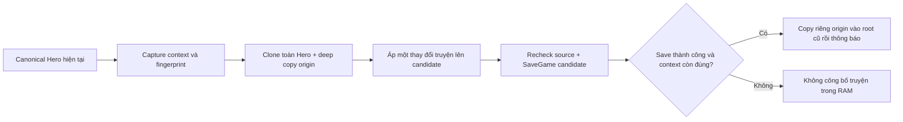

# Hàn Vụ N4 — Persistence hardening, 12/11/2026

## Kết quả và nền đã xác minh

Đã sửa lỗi công bố trạng thái truyện trước khi Save thành công và các guard còn
thiếu ở component origin. Giữ nguyên Save schema, `StoryOrigin.SaveVersion = 3`,
mọi field hiện có và semantics nhận/từ chối/đóng/bỏ qua. **N4 boundary regression
35 PASS/0 FAIL; N3 30 PASS/0 FAIL.** Đây là bằng chứng Cloud với I/O trong bộ nhớ,
không phải nghiệm thu Unity/Windows hoặc Save native.

- Worktree riêng: `/workspace/IdleGame-hanvu-n4`.
- Branch: `feature/cloud-hanvu-n4-persistence`.
- Base #24: `5063c3500b4cece64281d6ef3c1689484158c4ea`.
- **HEAD runtime đã kiểm:** `bbef36941e62effd38258947505837a80a5d1d89`.
  Checkpoint bàn giao tiếp theo chỉ bổ sung tài liệu/evidence/baseline runner;
  SHA HEAD cuối được ghi trong metadata/body của Draft PR sau push, tránh ghi
  SHA tự tham chiếu của chính commit tài liệu này.
- [Draft PR #25](https://github.com/lavievn/IdleGame/pull/25), target
  `feature/cloud-hanvu-n3-domain` (#24). Dependency **#13 → #17 → #24 → #25**.
- Fetch toàn bộ head origin trước làm và đối chiếu lại trước bàn giao. #24 vẫn
  tại base trên; không merge/cherry-pick/rebase nhánh khác, không đổi integration
  local. Đây **không** phải bản tích hợp Windows mới nhất.

| PR đã đọc/xác minh | HEAD | Quan hệ |
| --- | --- | --- |
| #13 foundation | `5915829aa2510a739bde64addf0a41b705c1b8eb` | Tổ tiên #17/#24 |
| #17 Hàn Vụ | `cc271451faccd4c2ba7d9ef679a93c7627bc5f5c` | Tổ tiên trực tiếp của nền N3 |
| #24 N3 | `5063c3500b4cece64281d6ef3c1689484158c4ea` | Nền N4 và target PR |
| #21 design baseline | `0ab8c88033ea9c4d97a7be4ed03705acad69f675` | Chỉ đọc, không nhập nhánh tài liệu vào runtime |
| #22 integration audit | `d8e08eb397446d4fdd6da9ed59d25df02025b1cb` | Chỉ đọc |
| #23 local handoff/slice | `382f389558ad956d2dc991df9ea91acdd16762fc` | Chỉ đọc |

Đã đọc AGENTS, README, project/Unity C#/Save Systems skills, báo cáo N3,
Narrative Design Baseline, Narrative Event/Timeline Foundation và Vertical Slice
Spec từ nhánh tài liệu đã xác minh. Những mô tả ledger/timeline tổng quát trong
Foundation là đề xuất; task N4 hiện tại cấm thêm persisted contract đó.

## Audit luồng lưu và công bố

Trước sửa, `TryOriginInteraction` gọi `StoryOrigin.Interact(runtimeHeroData)`
trực tiếp. `CommitOriginChange` hiển thị thành công rồi mới `SaveGame`; bool Save
thất bại không được trả về caller. Các lựa chọn thuốc/encounter, testimony,
prompt, arrival, wave credit và clue cũng dùng live state trước Save.

`SaveManager.SaveGame` hiện có validation trial/cultivation/equipment/realm/origin,
serialize toàn EntityDataSO, ghi temp và flush, rồi gọi
`CultivationMigrationTransaction.ReplaceExpected`. Writer dùng hash nguồn và
hash temp để từ chối file đổi trong quá trình replace; không phải một hàng đợi
Save bất đồng bộ. Không thay writer, thuật toán replace hoặc cultivation transaction.

Sau sửa:



- Mỗi lần thử dùng snapshot mới; **không giữ candidate toàn Hero để retry**.
  EXP/loot/Qi mới phát sinh sau lỗi được lấy từ canonical ở lần thử tiếp theo.
- `StoryOrigin.CopyState` tách guardian, companion, list và từng encounter record.
  Copy không normalize, migrate hay reroll. Publish giữ cùng canonical Hero và
  cùng root OriginStoryState để context N3 và binding progression không bị thay.
- Recheck Hero/story/map/actor spawn và JSON fingerprint trước Save, sau Save;
  guard reentrant ngăn hai transaction truyện lồng nhau. Cờ này private, không lưu.
- Chỉ publish story, cache stance theo hành vi cũ và housekeeping `isDirty` sau
  commit; không restore cả Hero/candidate lên runtime.
- Save false hoặc không có saver không phát notice thành công. Choice trả false
  để view giữ intent cho retry. Replay/no-op không tạo write mới.
- Arrival, accepted-wave story credit và exploration knot đi qua cùng helper.
  Domain/gating/wave balance không đổi; callsite knot tránh clone lại khi đã thấy.

### Load và dữ liệu ngoài origin

`GameManager.TryLoadSlot` vẫn Instantiate candidate riêng, gọi SaveManager,
kiểm progression/cultivation rồi mới `ApplyLoadedCandidate`. Không sửa đường
swap này. Test N4 chạy chính `TryLoadSlot` và các validator; phần scene deployment
và publication lifecycle cuối được mô hình hóa trong fixture.

Raw origin preflight mới chạy **trước** FromJsonOverwrite để không biến field
thiếu thành default hợp lệ. Yêu cầu field theo v1/v2/v3, kiểm scalar/nested actor/
encounter types, unknown fields, duplicate JSON fields và domain invariants.
Legacy thiếu/null origin và sentinel version0 vẫn giữ; v1/v2 đi qua UpgradeSave
sẵn có, không sinh NPC hoặc replay hậu quả. Writer kiểm incoming root và origin
hiện có trong slot, bảo vệ future/partial/unknown origin trước replace.

Snapshot toàn Hero bao gồm progression Level/EXP/realm, cultivationJson,
tribulationJson, combatSkills, equipment/Forge/Inventory và world-map của #24.
Các validator hiện có vẫn chạy. Fixture có Qi binding đang hoạt động, thao tác
Forge thực, equipment/resource và hai manual slot để chứng minh preservation.
`worldClimate` (#16) và `experienceJson` (#20) **chưa có ở nền #24**; không giả vờ
đã nghiệm thu chúng. Không sử dụng whitelist component khi capture toàn Hero;
phải giữ guard và binding của chúng khi tích hợp sau này.

## FAIL đã tái hiện và sửa

| Bằng chứng trước sửa | Nguyên nhân | Bản sửa / kết quả sau |
| --- | --- | --- |
| BeforeWrite, interrupted temp, BeforeReplace, temp observer: RAM đã sang SearchForest hoặc host trả true khi Save thất bại | Mutate canonical trước Save; bool bị bỏ qua | Candidate riêng; false ack; không công bố/notice thành công — PASS |
| Sau lỗi Save, retry không commit lại transition cùng EXP/loot/map mới | Story đã advance trong RAM ở lần lỗi | Fresh candidate từ current canonical mỗi lần — PASS |
| Writer CAS từ chối file cạnh tranh nhưng story RAM vẫn advance | Host không gắn publication vào kết quả Save | Giữ nguyên CAS; chỉ publish sau true — PASS |
| v3 bỏ `declinedHerbalOffer` vẫn Load và swap | JsonUtility default che mất presence | Raw origin field/type/domain preflight — PASS |
| Hero hỗ trợ ghi đè slot origin version99 | Writer không guard origin của slot đang có | Guard existing origin trước write — PASS |
| Unknown origin field cùng version vẫn Load, có thể mất ở lần Save sau | Version/domain validation chưa biết field lạ | Strict origin/actor/record field boundary — PASS |

Checkpoint `e03445760a6c33e57c2c194cf597657681c33aaa` chỉ thêm fixture;
Assets hoàn toàn bằng #24. **15 PASS/8 FAIL** trước sửa; đã chạy lại từ git archive
với kết quả tương tự. Checkpoint fix đầu `fcabaab182e4af980d7feab2777845e1c64ef342`
đạt34/0 sau bổ sung coverage. Test unknown-field được commit trước fix tại
`2b8f1d2` và tạo **34 PASS/1 FAIL**; fix nhỏ `bbef369` đạt35/0.
Không chỉnh assertion để làm xanh test.

Các hành vi đúng đã giữ nguyên: decline có thể accept lại, close/ignore trung lập,
M1/guardian projection từ stage, encounter pending không tự decline, testimony chỉ
sau dòng đã hiển thị, N3 stale-delegate retirement, replay/journal/Load không gọi
lại reducer để cấp effect. Không viết lại thoại, quest hoặc narrative framework.

## Validation và cấp bằng chứng

| Kiểm tra | Kết quả thực chạy |
| --- | --- |
| N4 trước fix, pinned baseline | **15 PASS/8 FAIL**, expected exit1; production #24 nguyên trạng |
| Unknown-field trước fix bổ sung | **34 PASS/1 FAIL**, expected exit1 |
| N4 cuối | **PASS35/35**:11 nhóm story/world cũ +24 nhóm N4; không cộng nhầm thành46 |
| N3 đầy đủ | **PASS30/30**, giữ assertions cũ; chỉ bổ sung persistence boundary thành công cho host candidate mới |
| Save success và lỗi trước ghi/trong temp/trước replace | **PASS boundary**; production SaveManager/writer/replace chạy, OS files ở bộ nhớ |
| Retry, duplicate/reentrant, stale Hero/map/spawn và source mutation | **PASS boundary**; bao gồm actual UI callbacks, context đổi trước/sau writer |
| Save → candidate Load → repeated Load | **PASS boundary**; không phải native gameplay Save/Load |
| Legacy thiếu origin/v1/v2/v3, null/version0; future/invalid/partial/unknown/type/duplicate | **PASS boundary** |
| Unrelated data, active Qi binding, equipment/Forge/resources/world, manual slots | **PASS boundary**; không bao gồm component chỉ có ở #16/#20 |
| Standalone toàn runtime Roslyn + DLL Unity6000.5.0f1 | **PASS0 lỗi/93 cảnh báo**, bằng baseline N3; không phải Editor import/Player build |
| Full historical Mono runner, compile-only | **BLOCKED12 lỗi cũ** trong Mathf/Vector2/TMP stub và HeroHealthMultiplier; không chạy executable/Save I/O |
| Metadata/GUID checker | **PASS0 lỗi/62 cảnh báo cũ**; không scene/asset/meta mới |
| Shell syntax, Python parse, Git diff --check | **PASS** |
| Native JsonUtility/Instantiate/Save I/O/atomic replace/fsync | **NOT TESTED** |
| Native Unity Load/Retry/Travel/death/entry và input, Windows Player/relaunch/teardown | **NOT TESTED** |
| Durable exactly-once cho command tổng quát hoặc event tự động qua crash | **BLOCKED** bởi contract hiện tại, xem giới hạn bên dưới |

Fixture thực thi production host fragment, UIManager.StoryOrigin, SaveGame,
TryLoadSnapshot, writer và ReplaceExpected. Chỉ thay engine JSON/clone và OS
File/FileStream/Directory bằng service test ở temporary build. JSON là fields-only
adapter, **không phải Unity serializer**. Không thay production transition/validator/
write algorithm bằng mock trả success. Stream hooks chỉ thu dữ liệu quan sát;
assert chạy sau khi Save trả về để catch của writer không nuốt assertion.
Không mở/ghi/xóa save thật; đường dẫn Save của fixture chỉ là key trong dictionary.
Automatic domain mutations chạy qua helper thật; không chạy native death/entry/
exploration lifecycle để tạo ra các command đó.

Chạy bằng Python3, C#7.2+, Mono và System.Web.Extensions:

```bash
bash Tests~/HanVuN4/baseline.sh  # expected exit1, 15/8
bash Tests~/HanVuN4/run.sh       # 35/0
bash Tests~/HanVuN3/run.sh       # 30/0
```

CSC/MONO có thể trỏ compiler wrappers đã cài. Chi tiết tại
[README fixture](../../Tests~/HanVuN4/README.md). Evidence:
[before](evidence/hanvu-n4/before.txt),
[unknown-before](evidence/hanvu-n4/unknown-before.txt),
[after](evidence/hanvu-n4/after.txt),
[N3](evidence/hanvu-n4/n3.txt),
[compile](evidence/hanvu-n4/standalone-compile.txt),
[full-runner blockers](evidence/hanvu-n4/full-compile-blocked.txt),
[validation](evidence/hanvu-n4/validation.txt).

## Bảo đảm thực tế, blocker và nghiệm thu Windows

Trong contract main-thread **đồng bộ hiện có**, một thay đổi truyện hợp lệ chỉ
được công bố sau Save trả true, source/context còn đúng. Lỗi trước replace giữ
story RAM và final snapshot cũ; retry không dùng candidate cũ. Stage/flags/choices
đã lưu làm cho thao tác của slice idempotent; repeated Load không replay effect.

**Không tuyên bố durable exactly-once tổng quát.** Không có persisted command ID/
receipt ledger hoặc queue cho accepted-wave event. Wave/death đã được gameplay
chấp nhận nhưng Save story lỗi sẽ không được xác nhận như một story effect; task
không tự thêm queue/freeze/replay death để bù event qua crash. Retry một callback
wave đã bị host tiêu thụ không phải một protocol command có receipt để resume.

Test tiêm thay context/EXP ngay trong writer đã chứng minh giới hạn khác: file có
thể commit, nhưng host từ chối publish vào runtime đã đổi. Không rollback một
snapshot cũ lên Hero mới hoặc ghi ngược để che vấn đề. Writer production không có
yield/callback tại đây; test này là defensive boundary, không chứng minh một race
native đã xảy ra. Hash guard hiện có bảo vệ file đổi trong replace, không chứng
minh ownership/revision xuyên process hoặc power-loss durability.

Nếu cần các bảo đảm rộng hơn, giao task persisted-contract riêng: thiết kế identity
command/outcome/effects cùng snapshot, version/migration tương thích và recovery
khi file đã replace nhưng chưa ack; kiểm failure sau replace/relaunch bằng fixture
native sở hữu. Đây là **phương án cần phê duyệt riêng**, không được triển khai ở N4
này và không dùng cờ RAM để thay receipt bền vững.

Cần nghiệm thu tại Windows trên HEAD tích hợp thực được xác định riêng:

1. Unity import/compile, native serialization/clone, version0/null và saves v1/v2/v3
   thật; future/partial/unknown không đổi canonical hoặc tệp gốc.
2. Fixture sở hữu trước Awake, marker/path guard đúng quy tắc máy D:; fault trước
   ghi/trong temp/trước và sau replace, đóng/relaunch rồi Load lặp; không dùng save cá nhân.
3. Nhận/từ chối/đổi ý, đóng/bỏ qua; sắc thuốc M0→M1 một lần, guardian/Cô Hồn Lâm
   đúng; retry choice sau Save lỗi; stale UI qua Retry/Travel/Load thật.
4. Snapshot ghép EXP bank/Qi/loot/equipment/Forge/skills/world-map/weather; identity,
   counters, bindings và manual slots giữ nguyên. Idle không tự chọn truyện.
5. Đúng Windows Development artifact/renderer; tách kết quả chạy khỏi crash teardown.
   Các lỗi teardown của #16 không được coi là đã sửa bởi N4.

## File, checkpoint và rủi ro tích hợp

| File production | Thay đổi giới hạn |
| --- | --- |
| Assets/Script/GameManager.cs | Candidate-before-save/publication và routing các mutation origin đã có |
| Assets/Script/HanVuOrigin.cs | Deep copy; pure validation theo state; raw origin JSON preflight |
| Assets/Script/SaveManager.cs | Chỉ thêm origin guard ở Load trước overwrite, incoming write và existing slot; không đổi writer/Save contract |

Tests~/HanVuN4 chứa boundary fixture/evidence reproduction; N3 Boundary/run chỉ
thêm saver sink và SaveSlot để biên dịch helper mới, không sửa regression assertions.
Không thay EntityDataSO, schema/version/migration, SaveManager transaction engine,
EXP/Qi/Combat/Blood/Inventory/Forge/Loot rules, Weather/Audio/Sky/Camera/HUD,
scene hoặc Unity assets. Các thay đổi SaveManager là cần thiết do các FAIL raw
partial/future/unknown slot; chỉ sửa host không thể chặn raw Load/direct writer.

Đã đối chiếu đúng diff của các PR, không merge mô phỏng:

- #16 `c00dae628a7ea47ca18b9b16dfd13bd86fd9b216`: trùng file production
  GameManager.cs và SaveManager.cs. Khi ghép, giữ `WorldClimateState.TryRead` ở
  incoming/existing write và Load, cùng worldClimate clock/owner binding. Không
  thay snapshot bằng DTO chỉ có origin, không copy nguyên file của bên nào.
- #20 `7601c372d82f034e4e7165cb000cc400fabbde84`: trùng SaveManager.cs trong
  diff PR; incoming/existing experienceJson guard và Load candidate binding nằm
  gần các guard N4. Giữ `experienceBinding` của canonical khi chỉ publish story;
  không gán cả cloned Hero/binding vào runtime. N4 không chạy EXP reserve release.
- Đây là file/hunk risk, **chưa phải xác nhận merge conflict hoặc integration PASS**.
  Những component không tồn tại ở #24 phải được test lại sau khi ghép thật.

Checkpoint: `e034457` test FAIL trước sửa → `fcabaab` candidate/guards và coverage →
`2b8f1d2` unknown-field FAIL → `bbef369` strict guard → checkpoint tài liệu/evidence.
Đã bảo toàn các worktree #20, N3, local baseline và narrative audit tại HEAD ban
đầu; không đổi nhánh đang có tác vụ khác.

Stop N4 tại các fix có reproduction và regression trong phạm vi này. N0/N1,
N5/N6, general Event System, tuổi thọ/bế quan và persisted-contract migration
không được thực hiện. Draft giữ để chờ review và native acceptance.
