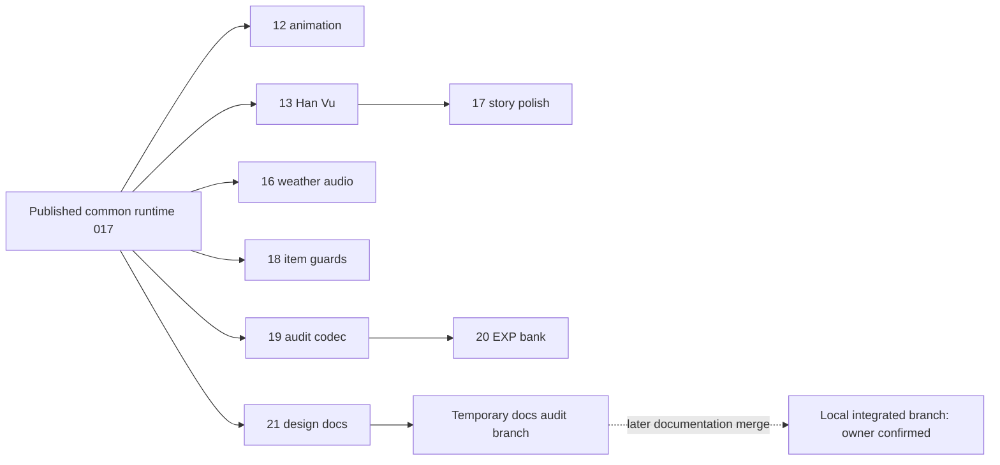

# Integration Audit & Narrative Foundation — 12/11/2026

## 1. Kết luận, nguồn và phạm vi

**Chủ dự án xác nhận các nhánh tính năng đã được merge trên nhánh local; sẽ merge
nhánh tài liệu tạm này sau.** Cloud không có tên/SHA, working tree hoặc artifact
của bản local đó. Vì vậy việc **đã merge local** là thông tin do chủ dự án cung
cấp; thành phần và nghiệm thu của **bản build tổng hợp local là BLOCKED** cho đến
khi có snapshot. Không kết luận rằng chưa tích hợp ở mọi nơi, cũng không gán bản
local cho `main`, `development_0.1.7`, #12 hay #20.

Đã kiểm tra GitHub #12/#13/#16/#17/#18/#19/#20/#21, các PR đang mở khác và truy vấn
PR mới ngày12/11. Trước khi mở PR tài liệu này, số mới nhất tìm thấy là #21.
Các head đã fetch khớp SHA từ API. `git fetch --all` ban đầu chưa đủ vì cấu hình
fetch origin chỉ theo dõi main; đã fetch rõ `refs/heads/*:refs/remotes/origin/*`.
Không thay cấu hình remote, merge/rebase/cherry-pick hoặc force-push.

| Đối tượng | Snapshot kiểm toán |
| --- | --- |
| Repository / origin | `lavievn/IdleGame` / `https://github.com/lavievn/IdleGame.git` |
| Worktree ban đầu | `/workspace/IdleGame`, `feature/cloud-exp-bottleneck-mastery`, HEAD `7601c372d82f034e4e7165cb000cc400fabbde84`, sạch |
| Worktree riêng của task | `/workspace/IdleGame-narrative-audit`, nhánh tạm `docs/cloud-narrative-integration-audit` |
| Base tài liệu | PR #21, `docs/2026-11-12-canonical-direction` @ `0ab8c88033ea9c4d97a7be4ed03705acad69f675` |
| Nền runtime chung đã công bố | `development_0.1.7` @ `fafc02d613a2e6a15c72a8dd48b935d2faa54f0e` — dùng để so diff, **không gọi đây là build local mới nhất** |
| Default origin | `main` @ `a774218ae613d56e9ab703de78f19eecc6a4d1fe`, không chứa các head #10–#21 đã rà |
| Nhánh runtime local đã tích hợp | Theo xác nhận chủ dự án; tên/SHA/build chưa có trên Cloud |

Không thấy worktree tích hợp khác trong registry của checkout Cloud tại lúc bắt
đầu. Worktree riêng bảo vệ cả checkout ban đầu và công việc local ngoài Cloud.
Chỉ sửa tài liệu; không sửa C#, scene, asset, cân bằng hoặc Save schema.

Đã đọc ba tài liệu PR #21: README, AGENTS và
[Narrative Design Baseline](../NARRATIVE_DESIGN_BASELINE_2026-11-12.md); skill dự
án/Unity/Save, hướng core loop, contract Dual Progression, báo cáo các PR và mã
liên quan. Phần Karpathy trong AGENTS #12 cũng được đối chiếu; không cài skill,
SDK hoặc cập nhật bộ skill của dự án.

## 2. Cách đọc trạng thái

| Nhãn | Ý nghĩa trong báo cáo |
| --- | --- |
| `VERIFIED` | Đã kiểm chứng thuộc tính cụ thể trên nguồn/commit nêu rõ, hoặc phép kiểm thực chạy trong phiên này; luôn ghi cấp bằng chứng |
| `IMPLEMENTED_UNTESTED` | Có implementation trên head cụ thể, chưa nghiệm thu ở cấp đang hỏi |
| `PARTIAL` | Có một phần hoặc có kết quả riêng lẻ, chưa đủ toàn yêu cầu |
| `GAP` | Sau khi truy vết luồng liên quan vẫn chưa có phần cần thiết |
| `PROPOSED` | Đặc tả/khuyến nghị; chưa triển khai hoặc chưa được phê duyệt triển khai |
| `BLOCKED` | Thiếu snapshot, môi trường hoặc artifact để xác minh |

PASS/FAIL/NOT TESTED là **kết quả kiểm tra**, không thay các nhãn implementation.
“Báo cáo Windows PASS” dưới đây nghĩa là có báo cáo được commit trên nhánh ấy;
Cloud không mở được log ổ D để tái xác nhận. Không cộng các số PASS thành chứng
nhận bản hợp nhất. PR mở cũng không đồng nghĩa mã chưa có trong một nhánh khác.

## 3. Ma trận PR, phụ thuộc và tích hợp công bố

Các PR trong bảng đều **OPEN, DRAFT** tại snapshot; không thay trạng thái của chúng.
SHA đầy đủ, diff paths và kết quả ancestry nằm trong
[repository-pr-snapshot.json](evidence/narrative-integration-2026-11-12/repository-pr-snapshot.json).

| PR | Head / SHA ngắn | Base trực tiếp | Trạng thái và bằng chứng đúng nhánh |
| --- | --- | --- | --- |
| [#12](https://github.com/lavievn/IdleGame/pull/12) | `development_0.1.8-cloud` / `5d41014` | development_0.1.7 | `IMPLEMENTED_UNTESTED` ở cấp native: 103 PNG và bridge, 9 scenario boundary được báo cáo; import/Play/Player chưa chạy, license exit198 |
| [#13](https://github.com/lavievn/IdleGame/pull/13) | `feature/story-origin-thanhkhe-foundation` / `5915829` | development_0.1.7 | Hàn Vụ có code, v3, optional encounters; báo cáo Unity7/7 + hồi quy017 5/5 và Windows WARP7/7 exit0. Native input và nhịp chơi mặc định chưa chạy |
| [#16](https://github.com/lavievn/IdleGame/pull/16) | `feature/dynamic-sky-weather-cycle` / `c00dae6` | development_0.1.7 | `PARTIAL`: climate/HDR/rain/audio có code và báo cáo native; phần chạy PASS nhưng teardown Windows FAIL; asset/nhạc thật giữ local |
| [#17](https://github.com/lavievn/IdleGame/pull/17) | `feature/cloud-hanvu-story-polish` / `cc27145` | **#13** | Sửa thời điểm ghi lời kể/đóng thoại/HUD;11 nhóm Cloud PASS. Các sửa mới này chưa có Unity/Windows PASS |
| [#18](https://github.com/lavievn/IdleGame/pull/18) | `feature/cloud-item-loot-foundation` / `9349f5f` | development_0.1.7 | Catalog/version/ID guard;19 nhóm Cloud PASS. Không dùng native smoke017 chứng minh fix #18 |
| [#19](https://github.com/lavievn/IdleGame/pull/19) | `feature/cloud-dual-progression-audit` / `2b88eb5` | development_0.1.7 |29 nhóm domain và17 mô phỏng được báo cáo; sửa DTO reuse. Chưa có EXP bank trên chính #19 |
| [#20](https://github.com/lavievn/IdleGame/pull/20) | `feature/cloud-exp-bottleneck-mastery` / `7601c37` | **#19** | EXP bank/release có điều kiện, Mastery contract;50 nhóm domain PASS được báo cáo. Save/native/Player và Mastery award chưa được chứng minh |
| [#21](https://github.com/lavievn/IdleGame/pull/21) | `docs/2026-11-12-canonical-direction` / `0ab8c88` | development_0.1.7 | `VERIFIED` documentation-only: ba file, +153 dòng, không đổi runtime; base của nhánh tài liệu tạm này |

**Ancestry đã kiểm:** head #13 là tổ tiên #17; #19 là tổ tiên #20.
Không remote head nào chứa đồng thời head #12, #13 và #16. Điều này không phủ
nhận merge local đã được chủ dự án xác nhận. `development_0.1.8-cloud` là nhánh
animation mới hơn nền017, không phải nhánh công bố tất cả tính năng.

PR #10 (`31e5e6c`, loot presentation) và #11 (`53df3ff`, awareness/HUD) vẫn mở
nhưng **cả hai head đã là tổ tiên của development_0.1.7**. Không xếp chúng thành
“chưa tích hợp” chỉ từ trạng thái PR. PR #9 và các PR2–7 cũ không được chọn làm
nền mới và không cần merge lại để thực hiện audit này.

Mũi tên dependency không biểu thị task này đã merge gì; nhánh local chưa được
đối chiếu với từng head nên không suy rằng có đủ #17/#18/#19/#20.

## 4. Trạng thái hệ thống của bản tổng hợp

| Hệ thống | Mã đã xác định / trạng thái nguồn | Kết luận cho build local tổng hợp |
| --- | --- | --- |
| Hero animation | #12 mở rộng CultivationSpriteBridge, shared PNG; Attack còn fallback một frame0.16s, không có bộ Attack/Cast/Death mới | `BLOCKED` nghiệm thu local; không gọi animation hoàn chỉnh từ103 PNG |
| Hàn Vụ / optional story | #13/#17, StoryOrigin/HanVuNarrative/HanVuEncounters, identity và Savev3, không hard travel gate | Owner báo đã merge nhánh; exact patch level và end-to-end tổng hợp `BLOCKED` |
| Day/night/weather/HDR/rain | #16 WorldClimate riêng,780s/ngày; adapter/fallback, storm/splash/ripple | Code `VERIFIED` trên #16; asset và cấu hình local/build tổng hợp chưa đọc được |
| Audio | Nền017 có BGM/SFX; #16 thêm ambience/weather loops và BGM streaming/crossfade | `PARTIAL`: slot ambience mặc định null,12 WAV/vendor assets không track; nghe loa/native input chưa được báo PASS |
| HUD | Nền017 có W3/B2; #13/#17 thu gọn theo Hero thực và bố cục thoại/journal | Cần nghiệm thu phối hợp animation–weather–story; `BLOCKED` cho bản local |
| Inventory/Forge/Loot | Nền017 có instance/8 slot/compare/Forge, hai stream độc lập; #18 bổ sung integrity/guard | Nền có native smoke báo cáo; fix #18 còn riêng head đã công bố, local patch level chưa biết |
| Loot VFX | Head #10/#11 đã trong nền017; VFX trình bày sau grant, không làm authority thưởng | Code có trong các nền công bố; delay/hình ảnh/native input của build local chưa xác nhận |
| Camera/awareness/combat | Nền017 có Multi-Zone/B2/routing/awareness, weapon basics và skill resources | Không chỉnh; vị trí camera mục tiêu35% và hành vi tổng hợp chưa được nghiệm thu trong phiên |
| Dual Progression/Qi | Nền017 có binding/session, foundation/reserve độc lập Level, DEV trial; #19 sửa capture | `VERIFIED` code phân nguồn; native tổng hợp `BLOCKED`; mô phỏng production không chứng minh presetDEV |
| EXP reserve/Mastery | #20 có experienceJson/bank/exact-once candidate, terminal không khóa Level; Mastery DTO/evidence | EXP `IMPLEMENTED_UNTESTED` ở cấp native; Mastery awards `GAP`, policy chưa chốt |
| Thiên Kiếp/Tinh Huyết | DEV Thiên Quan có đường combat/commit, retail production chưa successor/trial; Blood domain có nhưng gameplay khóa | `PARTIAL`; không tự unlock hoặc đổi whitelist stat/rate để khớp định hướng |
| Save/Load/Travel/Retry | Nền có candidate-before-swap; #13 originStory, #16 worldClimate, #20 experienceJson | Kết hợp ba thành phần cần native compatibility/fault tests; không lấy từng smoke riêng làm PASS chung |
| Narrative timeline/NPC lifecycle/lifespan/retreat | Stage/flags hiện có là nền hẹp; chưa có timeline lịch truyện, lifecycle tổng quát hoặc bế quan | `GAP` implementation; thiết kế bên dưới và hai đặc tả đi kèm là `PROPOSED` |

## 5. Đồng bộ tài liệu, giữ lịch sử và thông tin mới

| Khác biệt | Cách chuẩn bị giải quyết |
| --- | --- |
| README tháng10 mặc định mọi W3 làm trên main | PR21 ưu tiên xác minh branch/PR; giữ nguyên khối lịch sử, không dùng nó để chọn nền runtime |
| Core loop05/11 và roadmap cũ ghi Level luôn tăng/realm mỗi30 Level | Quyết định12/11 về hai authority và EXP bank có đường đột phá ưu tiên; thêm chỉ dẫn đến baseline mới, không sửa số/logic trong mã |
| Ngày môi trường780s dễ bị coi là ngày tuổi NPC | Ba đồng hồ độc lập theo phương ánB; không map weather day sang tuổi/ending |
| Legacy HP theo thế, Blood mọi stat, heatmap trong map | Design goal khác runtime: không tự sửa MaxHP, whitelist Blood hoặc thêm sampler từ tài liệu |
| Thanh Khê/Lâm Thanh/5 hồi/ending/tuổi/bế quan | Đề xuất chưa chốt; Hàn Vụ hiện có được giữ, không thay tên hoặc gán số tuổi |
| AGENTS #12 có Karpathy, #21 có priority block mới | Hai phần thêm ở vị trí khác nhau. Giữ cả hai khi merge local; không phủ nguyên AGENTS của local bằng blob #21 |
| Các thông tin sau thời điểm PR21 / merge local | Chưa nhận được snapshot local; chỉ thêm audit có nguồn và cảnh báo, không xóa thông tin local không có trên Cloud |

Chuẩn bị trên nhánh tạm: giữ nguyên Narrative Design Baseline của #21; bổ sung
liên kết đầu README/AGENTS và chỉ dẫn ưu tiên ở core-loop cũ, cùng báo cáo và đặc
tả. Diff của task không xóa đoạn README/AGENTS lịch sử hoặc phần Karpathy. Khi
merge vào local đã có #12, giữ block Karpathy hiện hữu và block12/11 của #21;
không chọn ours/theirs cho toàn file. Đây là chuẩn bị tài liệu, không merge #21.

Có [bản AGENTS kết hợp để review](evidence/narrative-integration-2026-11-12/AGENTS_PREPARED_UNION.txt):
ghép các đoạn thêm từ nền chung bằng xử lý văn bản trong bộ nhớ, không merge
Git/PR hoặc áp vào worktree local. Kiểm tra xác nhận các vị trí thêm độc lập và
giữ đủ Karpathy/priority/audit notice. Đây là mẫu theo snapshot đã ghim, không
được chép đè nếu local còn có thông tin mới hơn.

## 6. Kiến trúc và vertical slice bàn giao

[Đặc tả Narrative Event / Timeline / NPC / Persistence](../story/NARRATIVE_EVENT_TIMELINE_FOUNDATION_2026-11-12.md)
đặt **một authority truyện**, mở rộng StoryOrigin và HanVuEncounters theo từng
bước. Không thêm NarrativeManager singleton cạnh hệ Hàn Vụ. Journal và map là
projection từ facts; command/revision/receipt phải được lưu cùng hậu quả trong
candidate. Ba đồng hồ không gọi chéo để tăng tuổi hoặc chọn nhánh.

[Đặc tả slice Hàn Vụ](../story/HAN_VU_VERTICAL_SLICE_SPEC_2026-11-12.md) dùng lời
nhờ tìm lá bạc đang có, hai lựa chọn nhận/từ chối, trạng thái tạm dịu ho của người
giám hộ và quyền tương tác dấu vết ở Cô Hồn Lâm. Một mốc logic sau sắc thuốc,
không gán số năm. Bỏ qua vẫn trung lập; từ chối có thể nhận lại như mã hiện tại.
Không thêm NPC, thoại, kết cục, reward/buff hoặc map mới. Timeline tổng quát và
persistence mở rộng vẫn cần task triển khai/migration riêng.

## 7. Lỗi, thiếu sót và rủi ro cụ thể

| ID | Bằng chứng / mức độ xác nhận | Việc cần làm sau, không sửa runtime ở task này |
| --- | --- | --- |
| R1 | #16 báo Windows exit `-1073741819`, UnityPlayer.dll `0xc0000005`, offset0x1dd029 sau smoke; chạy soak và teardown phải tách kết quả | Tái hiện trên đúng build local, phân biệt RTX/D3D11 với WARP; giữ lỗi thoát là FAIL đến khi có bằng chứng sửa |
| R2 | #16 ignore HDR/RainMaker/WorldClimateVendor/WorldMapMusic; ambience slots mặc định null | Lập manifest asset/build local và kiểm tra nghe thực; source checkout không bảo đảm có âm thanh/asset thật |
| R3 | #12 chưa native import, thiếu metadata mới; báo checker moved-without-meta là heuristic liên quan orphan cũ | Import có license trên máy nhà, không tạo GUID giả hoặc sửa metadata ngoài phạm vi |
| R4 | CommitOriginChange trên #17 mutate live rồi SaveGame; thất bại chỉ báo chưa lưu, không rollback thành candidate | Không có bằng chứng lỗi quest hiện tại phát thưởng trùng; vẫn `PARTIAL` cho transaction nhân quả/reward tổng quát. Cần candidate/receipt trước mở rộng |
| R5 | Origin validity kiểm sau FromJsonOverwrite; đường GameManager dùng candidate, gọi trực tiếp SaveManager.LoadGame lên canonical không bảo đảm rollback | Test fail-closed trước swap và future/invalid components; không tuyên bố toàn SaveManager atomic |
| R6 | Encounter records có ID/terminal guard; Available trả ngay khi offer đầu cùng map đã terminal; hiện ba offer ở ba map khác nhau | Khi mở nhiều event/map, sửa qua task domain có regression; hiện là giới hạn mở rộng, không phải lỗi nội dung đã tái hiện |
| R7 | CreditWave tin accepted-kill/wave host; chưa có receipt narrative độc lập. NPC woodcutter chỉ là nhãn, guardian condition suy từ stage | Không tái dùng callback thô cho reward/milestone mới; giữ stable actors hiện hữu, chốt identity mới trước lifecycle tổng quát |
| R8 | Blood gameplay/production trial/position heatmap/Mastery award chưa có đủ dù định hướng mong muốn | Ghi GAP/PARTIAL, không unlock hoặc thiết kế rate trong audit |
| R9 | Root components originStory/worldClimate/experienceJson cùng chạm EntityDataSO/SaveManager ở nhiều nhánh | Đối chiếu bản local không được mất một component, future guard, legacy absence reset hoặc candidate-before-swap |
| R10 | Không có local SHA/build trong Cloud; PR native reports là các timeline khác nhau | Chặn chứng nhận build tổng hợp, không chặn hoàn thành tài liệu audit/đặc tả này |

File overlap trực tiếp (không phải kết luận conflict hunk), chi tiết tại
[pr-file-overlap.json](evidence/narrative-integration-2026-11-12/pr-file-overlap.json):

- #13 ↔ #16: EntityDataSO, GameManager, SaveManager, MainGameFoundationProbe,
  WindowsDevelopmentAcceptanceV10 và hai launcher Tools.
- #20 ↔ #13: EntityDataSO, CombatManager, SaveManager, MainGameFoundationProbe,
  Tests~/run.sh; #20 ↔ #16: EntityDataSO, SaveManager, MainGameFoundationProbe.
- #17 ↔ #16: GameManager; #17 kế thừa các file tích hợp của #13.
- #21 ↔ #12: AGENTS; hai block thêm không loại trừ nhau.
- #18 không trùng file diff trực tiếp với các PR triển khai trong tập này;
  #19 là dependency #20, không áp codec/tests hai lần. Không merge thử runtime.

## 8. Kiểm tra thực chạy và bằng chứng native được kế thừa

**Trong task documentation-only này:** PASS kiểm tra HEAD/status/fetch/API-SHA,
ancestry, path/diff overlap; kiểm tra bảo toàn tài liệu, liên kết và diff được
ghi tại [checks.txt](evidence/narrative-integration-2026-11-12/checks.txt).
Không chạy gameplay hoặc Save I/O vì không đổi runtime và không có bản local.

| Cấp kiểm thử | Kết quả trong task này / bằng chứng trước đó |
| --- | --- |
| Domain/UnityStub | `NOT TESTED` mới trong task này. Báo cáo riêng: #12 9 boundary, #17 11, #18 19, #19 29, #20 50; không cộng dồn, #20 đã gồm29 nhóm #19 |
| Unity Edit Mode/import | `NOT TESTED`; #12 báo BLOCKED license. Không suy từ Roslyn DLL compile thành Editor import |
| Unity Play Mode | `NOT TESTED` mới; #13 báo7/7 +017 5/5, #16 báo smoke13 và cập nhật gió14; không áp kết quả ấy cho #17 hoặc build local |
| Native Save/Load | `NOT TESTED` ở build local; nền017/#13/#16 có báo smoke handler/fixture riêng. #20 mới kiểm tra component, chưa SaveManager gameplay |
| Windows build/Player | `NOT TESTED` mới;017 build0 lỗi/57 warnings, WARP5 nhóm exit0; #13 build0/58, WARP7 nhóm exit0; #16 build0/57, smoke chạy PASS nhưng exit FAIL |
| Chuột/phím/nghe thực/chơi toàn tuyến | Chưa có chứng nhận tổng hợp. #13/017 ghi native input bị Firewall che; #16 dùng handler và clip sấm fixture im lặng |
| Full Mono suite | Báo trước `BLOCKED` bởi12 lỗi stub/legacy. Task này không chạy lại, không sửa assertion và không gọi đó là failure mới |

Nguồn native chính: [017](DEVELOPMENT_017_REPORT.md),
[Hàn Vụ #13](https://github.com/lavievn/IdleGame/blob/5915829aa2510a739bde64addf0a41b705c1b8eb/Docs/automation-reports/HAN_VU_NARRATIVE_UI_POLISH_REPORT.md),
[PNG #12](https://github.com/lavievn/IdleGame/blob/5d41014eccd4e88d561c8fdb85fb7934ae248170/Docs/automation-reports/DEVELOPMENT_018_HERO_PNG_REPORT.md),
[weather #16](https://github.com/lavievn/IdleGame/blob/c00dae628a7ea47ca18b9b16dfd13bd86fd9b216/Docs/automation-reports/WEATHER_PHASE2_STORM_AUDIO_REPORT.md).
Log/ảnh ổ D được các báo cáo tham chiếu, chưa được Cloud mở trong task này.

## 9. Kế hoạch nhỏ theo phụ thuộc

| Thứ tự | Task tiếp theo / đầu vào | Điều kiện kết thúc |
| --- | --- | --- |
| N0 | Chủ dự án xuất SHA/status + manifest/build local đã merge | Biết thành phần, renderer/asset, profileDEV/production và trạng thái teardown; không merge lại các nhánh đã có |
| N1 | Review nhánh tài liệu tạm này và #21, áp vào local trong task được phép | Giữ README lịch sử, Karpathy và baseline12/11; ghi local head mới. Task hiện tại chỉ chuẩn bị |
| N2 | Duyệt slice có phạm vi ở đặc tả đi kèm | Hai lựa chọn/hậu quả từ nội dung hiện có, mốc logic, projectionNPC/map, không thêm lore/rate |
| N3 | Mở rộng domain event dưới StoryOrigin/HanVuEncounters sau N2 | Test conditions/neutral-close/dedup/stale/same-map offers, một writer; không tự thêm Save field |
| N4 | Task persistence + migration được duyệt riêng, sau N0/N3 | Candidate/receipt/effects cùng snapshot; absence/v1–v3/current/future/invalid/fault/rollback; fixture có quyền sở hữu |
| N5 | Nối timeline mốc và NPC/map projection sau N4 | Không timer tuổi/auto-choice; không có hai nguồn trạng thái; giữ Retry/Travel và identity |
| N6 | Nghiệm thu slice trên đúng build tổng hợp sau N5 | Domain → Edit → Play → Save thực → Windows/native input/AFK; PASS/FAIL riêng từng cấp và renderer |

Thọ nguyên số học, bế quan, NPC tự mô phỏng offline và hệ chơi lại không nằm
trong N3–N6. Chỉ quay lại sau task/công thức/nội dung được duyệt riêng.

## 10. Quyết định cần duyệt, không tự chốt bằng code

**Cập nhật sau audit:** Chủ dự án đã duyệt phạm vi slice và M0/M1 logic (mục1–2
dưới đây) trong task Local Integration Baseline. Không hỏi duyệt lại. Phạm vi
không thêm Save field; N0/N1 và native build còn chờ máy Windows. Xem
[bàn giao hiện tại](LOCAL_INTEGRATION_BASELINE_2026-11-12.md). Danh sách bên dưới
được giữ làm lịch sử của audit #22, không hủy phê duyệt mới này.

1. Chấp thuận slice tham chiếu Hàn Vụ hiện có; xác nhận đây là thử kiến trúc,
   không phải chốt toàn bộ khởi đầu/lore/kết cục game.
2. Chấp thuận mốc sau sắc thuốc là mốc logic cho thử nghiệm; chưa gán số năm,
   tuổi NPC hoặc thọ nguyên. Giữ từ chối có thể đổi ý như hiện tại.
3. Duyệt riêng contract migration/persistence và phạm vi task N3/N4 trước khi
   thêm command receipts hoặc mở rộng originStory; không đổi schema trong PR này.
4. Xác định local integration head/build dùng nghiệm thu và task xử lý teardown;
   không cần phê duyệt lại hai phương ánB đã chốt.

Các câu hỏi lore/thọ nguyên/bế quan/luân hồi trong baseline tiếp tục mở, không
được biến thành điều kiện tự mở rộng công việc sau khi bàn giao audit này.

## Bàn giao nhánh tạm

- Commit `55a8a4f1b5c3e6a7d918d62ba814de55b0cacfe9`: audit, hai đặc tả, chỉ dẫn
  thêm và bằng chứng; đã push `docs/cloud-narrative-integration-audit`.
- [Draft PR #22](https://github.com/lavievn/IdleGame/pull/22) target
  `docs/2026-11-12-canonical-direction` (#21), chỉ chứa diff nối tiếp tài liệu.
  Khi chủ dự án merge vào nhánh local, đối chiếu những thay đổi local mới hơn
  và giữ đầy đủ AGENTS/README thay vì thay nguyên file theo một head remote.
- Commit tài liệu bàn giao tiếp theo bổ sung phần này; không đổi runtime hoặc
  scope. Local/remote HEAD được đối chiếu sau push; không merge PR nào.
