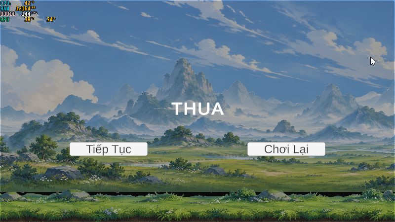

# Overnight Integration Batch v0.2 — bàn giao 05/11/2026

## Repository / commit

Branch `feature/monster-awareness-ambush`; worktree `C:\Users\hason\.codex\worktrees\loot-vfx-validation\IdleGame`. HEAD đầu `8a8e459593c044c4e52d164eb86d8b3f216af5f5`; đầu tác vụ sạch. HEAD mã/test đã hoàn tất `2e58c27`; `f8e760c` ghi camera BLOCKED. Commit chứa báo cáo này là HEAD bàn giao, SHA đầy đủ và đối chiếu remote ghi ngoài Git ở `outputs/progression-v01/summary.json`.

| Commit | Phần hoàn tất |
|---|---|
| `3b83271` | Nguồn chỉ số DEVB/baseline và context verifier cô lập chỉ đọc |
| `c34bc18` | API GameManager phân điểm + UI, ratio-preserving refresh, guard canonical Hero |
| `60b5496` | Kết nối mapping RankDatabase làm presentation |
| `3dd9163` | Điều chỉnh thành nhãn legacy/prototype theo thiết kế 15/10, cập nhật định hướng/roadmap |
| `c95b0c7` | Giữ HP/EXP/Physical luôn thấy ở panel 600 px, không bị giấu sau trang chi tiết |
| `d4c6a83` | Verifier MainGame progression/SaveLoad/Reset và world lifecycle hiện có |
| `2e58c27` | Thêm assertion phân điểm trong encounter sống, cả pause và resume |
| `f8e760c` | Báo cáo camera BLOCKED; không có candidate camera trong sản phẩm |

Push thực hiện theo chỉ dẫn bổ sung của người dùng, vào đúng nhánh tác vụ. Không force, đổi base, merge/rebase/main. Candidate camera chưa đạt không push. Không cần cài Unity/package/module mới.

## Ma trận từng phase

| Phase | Status | Commit | Evidence | Remaining issue |
|---|---|---|---|---|
| 1 — DEVB status | PASS trong fixture Editor/Mono | `3b83271`, `d4c6a83` | Live baseline/override/isolation label; Hero JSON không đổi khi đọc | Không đổi Release loader; không tuyên bố có profile manager |
| 2 — Allocation | PASS Editor routing + Mono | `c34bc18`, `2e58c27` | EXP cấp điểm, +6 HP/+1 Physical, ratio/timer/life, zero/repeat, equip/unequip, SaveLoad/New | Native Player allocation NOT RUN |
| 3 — Realm presentation | PASS **legacy/prototype** | `60b5496`, `3dd9163` | Mapping 1/10/11/100/101, không mutation/buff/save field; ảnh 600/800 | Hệ cảnh giới chính thức/Thiên Kiếp chưa triển khai |
| 4 — Feedback | PASS phạm vi đã chạy | `c95b0c7`, `d4c6a83` | Summary committed data, EXP/points, gear/equip/Forge; thiếu material báo thất bại, không mutation | Không thêm popup/VFX; không nghiệm thu mọi resolution |
| 5 — UI consistency | PARTIAL | `d4c6a83`, `2e58c27` | Editor panel/hit routing, pause, SaveLoad, Reset, Retry/Title; không giữ binding Hero cũ trong allocation | Native HUD targeting bị chặn; không kết luận toàn modal/input PASS |
| Camera bổ sung | BLOCKED | `f8e760c` chỉ docs | Mono đầu đo 0,6604665 khi chạy trái; dừng 6s = 0,6673297 FAIL; auto-review chặn thử thêm | Đã gỡ candidate, giữ camera cũ; Native camera/awareness measurements NOT RUN |
| 6 — World integration | PASS trong Editor verifier | `d4c6a83` | Natural kills, birth node, 5-wave clear, legal Travel, SaveLoad roots/gear/allocated data, combat, fixture defeat/Retry/Title | Không kiểm lại toàn vòng sau thay chữ/header chỉ đọc; không dùng làm PASS Player |
| 7 — Windows Player/native | PARTIAL / BLOCKED ở HUD | Build release từ runtime `d4c6a83` | Build PASS; native New/confirm/startup, auto combat/level/loot/AutoSave/defeat quan sát được | Character/Inventory/Forge/ManualLoad/Travel native NOT RUN |
| 8 — Handoff | Hoàn tất tài liệu và evidence | Commit chứa báo cáo | Hai báo cáo chức năng, camera report, ảnh/summary, Git checks | Dừng batch, không tự mở task mới |

## Kiểm thử và trình tự bằng chứng

- **Mono/UnityStub PASS 4/4** `--progression-ui` bản cuối. Test đọc nhãn nguồn, so Hero JSON không mutation; level-up nhận điểm; allocation qua GameManager; encounter sống khi pause/unpause; HP ratio/timer/life; real damage evaluator; zero points/repeated callback; gear equip/unequip; stale/dead binding; New và realm legacy. Không chuyển số PASS này thành Unity/native PASS.
- **Unity 6000.5.0f1:** verifier có sẵn `MainGameFoundationProbe.RunIsolated`, mở scene copy ignored, SaveManager inactive và đường dẫn GUID/marker trước Awake. Không đọc/ghi save người chơi. Lượt full `.utmp/foundation-1903610ab0484c20bde1c26402b48b36` có đầy đủ checks V02 P1–P6, failure rỗng.
- Trong full run: EXP fixture kiểm allocation ban đầu; sau public Reset, **combat tự nhiên** nhận Cung và material qua production service, callback chết trùng không cấp lại, equip/unequip qua UI routing; Special Forge thiếu material trả đúng thất bại và giữ nguyên gear/stock. Farm tiếp bằng combat thật, stock 12 → 1 sau Normal/Special; multiplier 1 → 1,02 → 1,16; Save/Load và combat trace dùng đúng stat.
- Tiếp tục birth node đến clear 5 wave, chủ động Travel node kề hợp lệ, giữ level/roots/equipment/allocated points/clear history, Manual2/Load, combat sau Load; gây defeat **chỉ trong fixture sở hữu**, Retry/Title/Continue giữ đúng dữ liệu. Không boss, không tự auto Travel.
- Chance được ép **1 chỉ trong process Editor thử** để có reward xác định; MainGame asset giữ material .60/1–2 và gear .08/Uniform Sword/Bow level1/Attack4/Common. Đây không phải phép đo tốc độ progression ở tỷ lệ thật.
- Sau điều chỉnh legacy label, chỉ chạy UI-only `.utmp/foundation-a70b859ec45c4a0387070a663663522b`. Ảnh 600 cho thấy số liệu chính nằm ở trang sau; sửa summary và kiểm lại UI-only `.utmp/foundation-d6699e1992ce403eb92dbc1d8c5db766`, 600/800 không overflow. Không lặp cả vòng farm cho thay đổi text/header này; các đường reward/world/save không đổi.
- Snapshot verifier mở rộng points, addedHealth/addedDamage và root identity; đây là DTO kiểm thử, **không phải Save schema** mới. Các lỗi chuẩn bị fixture ToJson/Call là khác biệt API stub, đã sửa theo API hiện có; không giảm assertion sản phẩm.
- Metadata checker **0 lỗi / 3 cảnh báo có sẵn**; whitespace/staged checks PASS. Không chạy Magic/full Forge/full UI matrix không liên quan.

## Windows Player thực chạy

Build x64 **Succeeded**, **0 errors / 48 warnings**, Mono2x, BuildOptions.None, 604.817.848 bytes. Dùng helper build cũ một lần; không đổi backend/package. Output cố định ngoài repo: `C:\Users\hason\Documents\Codex\2026-11-04\truy\outputs\player-validation\final-player\IdleGameValidation.exe`.

Company `IdleGameValidation`, product `Run-37b9d179c6024798b4b5c00d77e63334`; đã kiểm `app.info`, marker `.validation-owner` và đường dẫn không reparse. Save/PlayerPrefs thuộc profile mới dưới `AppData/LocalLow/IdleGameValidation/Run-37b9d179c6024798b4b5c00d77e63334`, không phải profile sản phẩm.

Người dùng tự chạy script Firewall và báo rule `IdleGameValidation-LocalSubnet-FCBB4BDC7401` Allow Private/Public. Agent không thực thi Firewall/UAC/Defender hoặc dùng cửa sổ PowerShell Administrator. Trong lượt native này không gặp hộp thoại Security/Firewall.

Lần launch đầu bị ẩn do `WindowStyle Hidden`, đã đóng đúng PID thử và khôi phục đúng một lần bằng `sky.launch_app` để có cửa sổ tương tác. Native mouse **thực sự** bấm Chơi mới và Xác nhận, qua opening vào combat. Sau đó bấm Nhân vật bị công cụ từ chối vì điểm nằm trên `ChatGPT.exe "Chrome Legacy Window"` phía dưới; đã activate/reobserve/retry một lần và vẫn bị chặn. Không gửi click bằng đường khác, không dùng handler để ghi PASS native.

Game vẫn tự chơi; AutoSave sở hữu cuối xác nhận **level 3, EXP 109, 2 điểm chưa dùng, 3 gear và 17 material**, allocation 0/0, world node HT-17; quan sát màn hình THUA. Đây là reward thật ở .60/.08, không override chance trong Player. Chưa bấm equip/Forge/Load/Travel bằng native. Các process Player/Editor của tác vụ đã đóng.

## File thay đổi / artifacts

Runtime: `GameManager.cs`, `UIManager.cs`. Test/verifier: `MainGameFoundationProbe.cs`, `Tests~/MotionRegression.cs`, `Tests~/ProgressionUiRegression.cs`. Tài liệu: core direction, integration roadmap, ba báo cáo và ảnh evidence.

Không sửa EntityDataSO/SaveManager/CombatDamage/CombatStats/Forge/loot config/catalog/AI/camera cuối cùng/MainGame/ProjectSettings/package/asset nguồn. Font fallback cache, settings tự serialize trong build, helper build tạm và 15 meta import của phiên đã dọn về trạng thái đầu; không commit output/log/save. Camera candidate giữ ở `work/camera-framing-v01`, không nằm trong branch.

Artifacts ngoài Git: `C:\Users\hason\Documents\Codex\2026-11-04\truy\outputs\progression-v01\`: các log Mono mới, filtered full/UI checks, JSON verifier/snapshots, build summary, native input record/data summary, metadata và final summary. Log đầy đủ ở `work/progression-v01`; ảnh 600/800 và Player cuối cũng commit trong `Docs/automation-reports/evidence/progression-v01` để xem trên GitHub. Xem [Progression report](PROGRESSION_UI_V01_REPORT.md) và [camera report](CAMERA_FRAMING_V01_REPORT.md).

## Vấn đề / giới hạn còn lại

- **P1 — Camera BLOCKED:** candidate dừng chưa đạt; auto-review từ chối lượt thử thêm vì kéo thời gian 6→20s bị coi là nới điều kiện và vượt giới hạn hai vòng. Không workaround; không phát hành. Cần ngoại lệ rõ ràng nếu muốn sửa/kiểm thử tiếp, giữ assertion thay vì ép PASS.
- **P1 — Player HUD/native targeting:** root cause giữa click-through/focus công cụ chưa xác định; không có bằng chứng click đã tới handler. Build/startup/auto loop PASS không đủ cho native acceptance toàn bộ.
- **Thiết kế cảnh giới:** mapping 10 cấp legacy khác thiết kế chính thức 30 cấp nội bộ + Level mốc đột phá + Thiên Kiếp hai pha. Chưa có state/migration/điều kiện chi tiết cho hệ chính thức; không thêm trong batch. Level tổng hiện tiếp tục bằng EXP, không khóa bình cảnh; giới hạn kỹ thuật level 999/cap EXP của code cũ vẫn giữ nguyên, chưa phải nghiệm thu progression vô hạn.
- **Sản phẩm hoãn:** MaxHealth theo mode vẫn prototype; không class cố định; không thêm MagicalAttack allocation, Staff/defense drop, võ học/công pháp/active skills/Thiên Kiếp/boss/elite/story/sect.
- **P2 log có sẵn:** Mono cảnh báo field không dùng/catalog stub; Editor Search/video/TLS và Player TLS/certificate error 35 đã được ghi, không thay chính sách hoặc xóa cache để giấu. Không kết luận Console tuyệt đối sạch từ build 0 errors.

## Tối đa ba việc tiếp theo

1. Nếu người dùng cho phép ngoại lệ camera: sửa nguyên nhân dừng với assertion giữ nguyên, rồi đo MainGame viewport/visibility/awareness; không tự đổi speed/AI/spawn.
2. Chẩn đoán native HUD click-through/targeting bằng bằng chứng mới và hoàn tất Character/Inventory/Forge/Load thật; giữ profile thử, không dùng Administrator để che vấn đề input.
3. Người dùng fetch nhánh này bằng GitHub Desktop, mở rõ `Assets/Scenes/MainGame.unity`, chơi thử progression; lưu ý DEVB cá nhân có thể đang bật. Không tự bắt đầu hệ gameplay mới từ roadmap.

**Dừng sau Phase 8.** Có thể mở Unity/chơi thử bản progression đã push; camera framing và native HUD acceptance còn thiếu, không tuyên bố hoàn thiện production.
