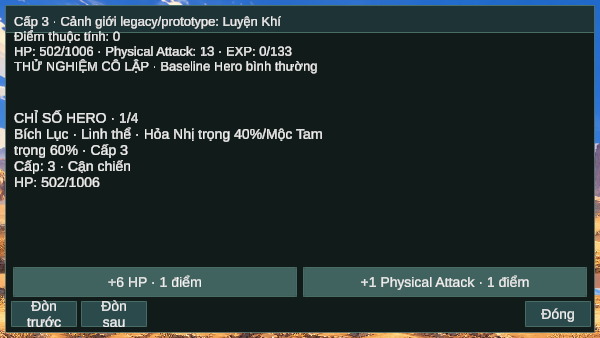
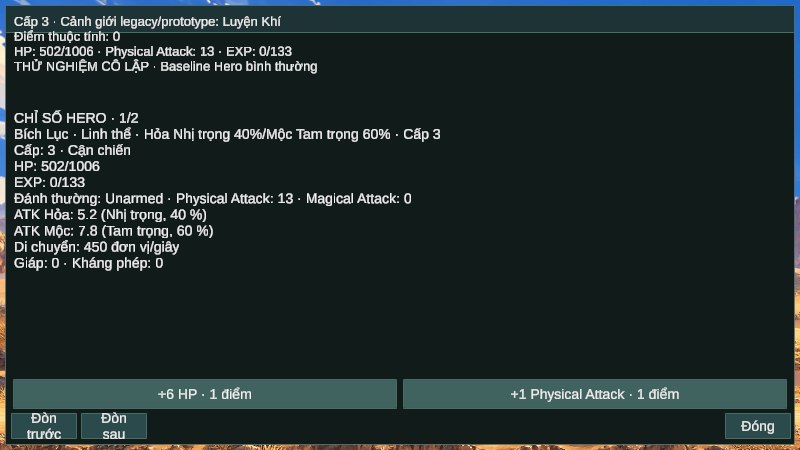

# Progression UI v0.1 — 05/11/2026

## Repository và những phần đã nối

Branch `feature/monster-awareness-ambush`, worktree giữ nguyên. HEAD đầu tác vụ `8a8e459593c044c4e52d164eb86d8b3f216af5f5`. Các commit runtime/test: `3b83271`, `c34bc18`, `60b5496`, `3dd9163`, `c95b0c7`, `d4c6a83`, `2e58c27`; nội dung từng commit xem [báo cáo batch](OVERNIGHT_INTEGRATION_V02_REPORT.md). Đã push theo chỉ dẫn bổ sung của người dùng, không force/merge.

- **DEVB:** nhãn Dev Tools và panel Nhân vật phản ánh baseline/DEVB Hero/DEVB quái; chỉ rõ các nhóm bị override. Cờ UI thử nghiệm cô lập chỉ được verifier đặt sau khi xác minh ownership thư mục Save; không thêm profile manager hoặc field Save. Không sửa loader/Release policy và không ghi/xóa `dev_balance.jsonl` cá nhân.
- **Phân điểm:** `GameManager.CanAllocateHeroAttribute`, `AllocateHeroHealth/AllocateHeroPhysicalAttack` gọi đúng API EntityDataSO. Guard canonical Hero ↔ combat state, deployed/alive, không pending confirmation, có điểm; callback không giữ bản sao Hero cũ. Một thao tác tiêu 1 điểm, +6 addedHealth hoặc +1 addedDamage; overflow bị từ chối.
- **Refresh:** dùng `RefreshRegisteredHeroStats(hero,false)` hiện có, giữ tỷ lệ HP và rounding hiện hành, không đưa máu đầy/reset timer/life/target. Khi MaxHP tăng, HP hiện tại có thể tăng tương ứng tỷ lệ cũ; đây là quy tắc refresh đang có, không thêm heal riêng. Dirty do API phân điểm đánh dấu, Auto/Manual Save hiện có lưu lại.
- **UI:** giữ panel/Canvas/TMP/theme hiện có, thêm hai nút độc lập nền, dim/disable khi hết điểm. Header luôn hiển thị level, points, HP/max, EXP, Physical Attack, nguồn DEVB và nhãn cảnh giới tạm, kể cả 600 px. Chi tiết còn lại dùng phân trang; không tạo hierarchy/listener mỗi frame. Log/damage panel dùng chung khung vẫn ẩn các nút phân điểm.

## Cảnh giới: điều chỉnh chính thức trong phiên

UI ghi rõ **“Cảnh giới legacy/prototype”**. `RankDatabase.GetRankName(level)` chỉ cung cấp tên tạm; test 1/10/11/100/101 xác minh mapping legacy, **không** nghiệm thu một hệ đại cảnh giới chính thức.

Thiết kế 15/10 được tái xác nhận: Level tổng tăng liên tục bằng EXP; mỗi đại cảnh giới 30 cấp nội bộ, Sơ 1–9/Trung 10–19/Hậu 20–29, từ 30 viên mãn/bình cảnh; tiểu cảnh giới tự chuyển, đại cảnh giới chỉ sau Thiên Kiếp thành công. Dự kiến Thiên Kiếp hai pha chịu đòn/gây đủ sát thương; Level tổng không reset, mốc tiến trình mới là Level lúc đột phá. Chưa có state mốc đột phá/tiến trình nội bộ/Thiên Kiếp hoặc schema tương ứng; **không triển khai chúng trong batch**. Đã ghi vào [định hướng](../CORE_GAMEPLAY_LOOP_DIRECTION_2026-10-25.md) và [roadmap](../architecture/INTEGRATION_ROADMAP.md).

## File thay đổi

- `Assets/Script/UIManager.cs`: source labels, live Character panel, summary và allocation controls/layout.
- `Assets/Script/GameManager.cs`: guarded allocation authority; không đổi các công thức đang có.
- `Assets/Script/MainGameFoundationProbe.cs`: mở rộng verifier CLI Editor hiện có, snapshot points/allocations/root, nhánh progression và vòng world; không có startup hook trong Player.
- `Tests~/MotionRegression.cs`, `Tests~/ProgressionUiRegression.cs`: selector `--progression-ui`, bốn ca fixture.
- Hai tài liệu định hướng/roadmap; các báo cáo/ảnh trong thư mục này.

Không đổi EntityDataSO/SaveManager schema, CombatStats/CombatDamage/Forge formula, ProductionLootConfig/catalog, loot .60/.08, AI, tốc độ/spawn hoặc artwork/font nguồn. Thay đổi camera thử nghiệm đã bị gỡ; xem [camera BLOCKED](CAMERA_FRAMING_V01_REPORT.md).

## Kiểm thử thực chạy

| Kiểm tra | Kết quả và phạm vi |
|---|---|
| Mono/UnityStub `--progression-ui` | **PASS 4/4** bản cuối; baseline/override/isolation chỉ đọc; EXP/points, HP ratio/timer/life, Physical/damage evaluator, encounter sống khi paused/unpaused, zero/repeat, equip/unequip, stale/dead binding/New và realm legacy boundaries. |
| Unity 6000.5.0f1 MainGame verifier | **PASS** UI hit-test/click routing; phân điểm, dữ liệu thật, Save/Load/Reset, pause, realm boundaries và header không overflow 600/800. **Không phải input native.** |
| Unity gameplay integration | **PASS** natural combat/gear/material/equip/Forge/SaveLoad; clear node, legal Travel, combat sau Load, fixture defeat/Retry/Return Title. Chi tiết ở báo cáo batch. |
| Windows x64 Release, Mono2x | **PASS build**, 0 lỗi/48 warnings; code sản phẩm như commit `d4c6a83` (commit `2e58c27` sau đó chỉ thêm assertion test). |
| Windows native startup/New | **PASS:** chuột thật bấm Chơi mới và Xác nhận; game tự chiến đấu, lên cấp/nhận đồ, AutoSave/defeat trong profile riêng. |
| Windows native Character/allocate/Inventory/Forge/Load | **BLOCKED/NOT RUN:** công cụ không gửi được click HUD; không thay bằng handler rồi ghi PASS. |
| Metadata / whitespace | **PASS:** checker 0 lỗi/3 cảnh báo folder có sẵn; `git diff --check`. |

Fixture Mono thiếu Resources thực nên có log catalog unavailable khi tạo UI/New; không coi là lỗi catalog MainGame: Unity và Player đã sử dụng world node thực. Các lỗi compile trong bước chuẩn bị test là chữ ký ToJson/Call của stub, đã sửa fixture đúng API hiện có; không làm yếu assertion sản phẩm. Không chạy lại Magic/Forge/full UI matrix không bị sửa.

## Ảnh và bằng chứng

Ảnh trực tiếp Editor ở bản header cuối, có nhãn legacy/prototype và số liệu thường trực:

Logs/results ngoài Git: `C:\Users\hason\Documents\Codex\2026-11-04\truy\outputs\progression-v01\`; log đầy đủ tại `work/progression-v01/` cùng workspace. Native UI được quan sát qua Computer Use, không có snapshot Character Player vì click đó bị từ chối. Các file JSON Save bằng chứng chỉ thuộc profile GUID/marker sở hữu.

## Giới hạn và ảnh hưởng thiết kế về sau

- Native HUD click còn bị chặn: điểm bấm được công cụ báo thuộc ChatGPT phía dưới Player; đã thử một lần activate/reobserve rồi retry, vẫn bị từ chối trước khi gửi click. Chưa phân biệt xong click-through của app với giới hạn targeting/focus công cụ; không khẳng định sản phẩm đã hỏng hit-test.
- Nhãn cô lập được verifier Editor đặt tường minh. Player validation tách profile qua company/product GUID và marker đã kiểm chứng ở ngoài ứng dụng; không dùng nhãn baseline Hero làm bằng chứng một profile người chơi hay profile thử.
- MaxHealth phụ thuộc mode hiện vẫn là prototype; không sửa ở đây. Phân Physical không tăng MagicalAttack. Staff/template phòng thủ chưa bật drop. Võ học/Mana/Thiên Kiếp vẫn hoãn, không thêm authority hoặc Save fields để lấp khoảng trống. Giới hạn kỹ thuật level 999/cap EXP hiện có giữ nguyên; chưa nghiệm thu progression dài hạn vô hạn.
- Chưa nghiệm thu Character mới ở 1150/1360 bằng ảnh/native; 600/800 là hai kích thước trực tiếp bị ảnh hưởng đã kiểm. Không tuyên bố UI/Player production hoàn thiện.
