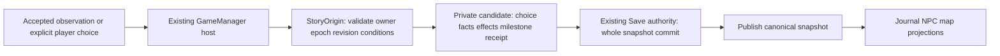

# Narrative Event, Timeline & Persistence — đặc tả kỹ thuật 12/11/2026

**PROPOSED, documentation-only.** Nguồn thiết kế là
[baseline12/11](../NARRATIVE_DESIGN_BASELINE_2026-11-12.md); trạng thái tích hợp tại
[audit](../automation-reports/NARRATIVE_INTEGRATION_AUDIT_2026-11-12.md).
Không có quyền triển khai schema, gameplay, tuổi thọ, bế quan hoặc content mới.
Các tên contract dưới đây là ký hiệu thiết kế, không phải API/field đã có.

## 1. Tái sử dụng trước khi mở rộng

Đã truy vết head #17 `cc271451faccd4c2ba7d9ef679a93c7627bc5f5c` (kế thừa #13).
Nguồn tại `Assets/Script/` trên head này; các file chưa tồn tại ở base tài liệu
không được hiểu là chưa có trong dự án.

| Thành phần đang có | Tái sử dụng | Giới hạn cần giữ rõ |
| --- | --- | --- |
| HanVuOrigin.cs: StoryOrigin / OriginStoryState v3 | Facade công khai và authority truyện Hàn Vụ; originId, guardian/companion IDs, stage, wave counters, flags | Một tuyến hẹp, chưa phải lịch truyện/lifecycle tổng quát |
| OriginDefinition / StoryOrigin.HanVu | IDs `hanvu`, `hanvu.find_medicine`; villageTV-20, forestTV-16, eliteTV-11 | TV-20 là alias Hàn Vụ theo origin, catalog gốc là Lạc Vân Trạch; không đổi ID/tên catalog toàn cục |
| HanVuEncounters.cs | Offer có stable ID/map/RequiredWaves; Observe, Choose, records Pending/Participated/Declined | Ba offer hardcode; mỗi map một offer hiện hành. Terminal guard có, chưa có command/revision ledger tổng quát |
| HanVuNarrative.cs | Dữ liệu thoại, cờ đúng câu đã nghe, khám phá knot/note, journal facts/testimony/inference | Woodcutter chưa có OriginActor ID; lời kể không phải world fact về số phận companion |
| GameManager TryChooseHerbs/TryChooseOriginEncounter/TryOriginInteraction | Một host kiểm readiness, trial liability, gọi domain và Save | Hiện mutate live rồi CommitOriginChange; Save thất bại chỉ thông báo, chưa phải candidate transaction |
| UIManager.StoryOrigin.cs | Hiển thị từng câu, choice/close/replay, journal; đóng stale view khi map/Hero/entry/death đổi | View không được trở thành nơi grant reward hoặc tăng timeline |
| StoryOrigin.Journal / ItemCount / IsSafe / CanInteract / HintMap | Projection từ facts; quest item count là dữ liệu suy ra, không phải grant Inventory mới | Không trao item khi xây journal hoặc load; không lấy HintMap làm điều kiện travel |
| SaveManager + GameManager candidate-before-swap | Version/legacy handling và cơ chế snapshot hiện có | Story validation hiện sau overwrite vào candidate; SaveManager.LoadGame trực tiếp lên canonical không bảo đảm rollback |

Ba ID encounter đã có là `hanvu.merchant_rumor`, `hanvu.herb_basket`,
`hanvu.wounded_traveler`. Guardian/companion IDs và tên/giới tính đã lưu phải giữ
nguyên qua Load. Không đổi ID để phù hợp tên văn học, không tự tạo NPC thay thế.

**Một authority:** mở rộng domain hiện có dưới facade StoryOrigin; HanVuEncounters
vẫn là catalog/adapter cho event Hàn Vụ. Nếu cần reducer thuần dữ liệu, nó là
implementation detail của facade này, không phải NarrativeManager singleton,
MonoBehaviour hoặc bộ tick độc lập. Không lưu hai bản NPC/world state cạnh nhau.

## 2. Narrative Event System

Tách ba trách nhiệm, cùng một nguồn trạng thái:

| Contract đề xuất | Vai trò |
| --- | --- |
| Event definition | ID giữ ổn định, version nội dung nếu cần, điều kiện, choice IDs, effect plan và mốc hội tụ; bắt đầu bằng definition hiện có |
| Narrative state | Records quan sát/lựa chọn/kết quả, factsNPC/world, milestone frontier, revision và receipts; chưa ấn định serialized shape |
| Command | Hero owner, runtime epoch, command ID, event ID/instance, expected revision, choice hoặc observation được xác nhận, nguồn evidence hợp lệ |

Luồng dự kiến:

1. **Evaluate** là phép đọc: eligibility/available options không nhận thưởng,
   chọn branch hoặc đánh dấu hoàn thành. Trigger khám phá chỉ tạo offer/observed
   fact khi có evidence đúng map/quãng đường/wave đã được host chấp nhận.
2. **Observe** khác **Choose**. Close/ignore/AFK không thành Declined. Câu thoại
   chưa hiện không được ghi là đã nghe; replay là đọc facts, không replay effects.
3. **Resolve** recheck owner/epoch/revision, source actor/map, prerequisite facts
   và choice hợp lệ; tính toàn bộ effect plan trước mutation. Không gọi trực tiếp
   handler bằng một chuỗi ID để bỏ qua điều kiện gameplay.
4. **Terminal event** không mở lại như event mới; command trùng trả kết quả đã
   commit, không cộng hậu quả lần nữa. Command stale bị từ chối và đọc lại offer;
   không tự chọn đáp án thay người chơi.
5. **Deferred/reversible choice** không bị gán terminal nhầm. HerbalParticipation
   Declined hiện có thể được nhận lại; giữ declinedHerbalOffer làm lịch sử. Các
   encounter Participated/Declined hiện là terminal. Definition phải nói rõ khác
   biệt này; không đổi semantics các save cũ bằng một enum Completed chung.
6. Đánh quái, Retry và pool callbacks không được tạo command ID mới cho cùng
   một event đã xử lý. UI phát lại cùng intent khi retry commit phải giữ ID;
   runtime epoch đổi khi Load để callback cũ không chạy vào Hero mới.

Effect plan chỉ dùng thao tác được whitelist và nội dung đã duyệt: ghi fact,
chuyển trạng thái NPC/world hợp lệ, milestone, hoặc giao dịch tài nguyên/item
hiện có nếu task sau cho phép. Chưa có reward mới cho slice. Nếu sau này thêm
reward, việc đổi Inventory/cost và ledger phải ở **cùng candidate Save**, giữ ID
instance; journal/UI/Load không gọi grant. Không tạo công thức hay bảng cân bằng.

Khi thêm nhiều event/map, Available phải duyệt được các offer còn lại sau một
record terminal, có thứ tự ổn định được định nghĩa; không dựa vào incidental
callback order. Đây là task domain riêng có regression, không thêm scheduler
phổ quát trước khi có nhu cầu nội dung.

## 3. Story Timeline độc lập

| Đồng hồ / authority | Đầu vào | Không được thực hiện |
| --- | --- | --- |
| EnvironmentClock (#16 WorldClimate) | Frame được phép, seed, day/dayFraction, cấu hình môi trường | Tăng tuổi NPC, giảm thọ nguyên, chọn ending hoặc kết luận đã bế quan |
| Progression (nền017: cultivation binding/Combat/EXP authority; #20 EXP mở rộng) | Active gameplay dt / kill hợp lệ và các command riêng | Mượn mốc Level, Qi cap hoặc60 phút production làm chapter/tuổi truyện |
| StoryTimeline (đề xuất trong cùng narrative authority) | Event milestone hợp lệ đã commit | Tự advance vì Update, wall-clock, timeScale, số wave hoặc thời gian offline |

Timeline là frontier/milestones với prerequisite, không cần bộ đếm năm để thử
slice. M0/M1 là ký hiệu kiểm thử cho trước/sau việc sắc thuốc đã có, không phải
canonical IDs, số tuổi hay một năm lịch sử. Chỉ command event hợp lệ mới đổi mốc.
AFK không resolve một quyết định đang chờ. Combat HP0/Retry không phải sự kiện
tử vong truyện; Travel/Load không tự tăng mốc. Wave có thể cung cấp evidence
đủ thuốc như hiện tại nhưng không tự chọn mang thuốc về/sắc thuốc.

Một nhánh có thể hội tụ ở milestone nhưng giữ choice history, NPC state và
world facts khác nhau. Không xóa hậu quả để ép mọi save thành cùng kết quả.
Đối với save cũ đã SearchForest hoặc muộn hơn, có thể **đề xuất** derive milestone
đã đạt từ stage; không phát lại command, reward, tuổi hoặc sự kiện khi migration.
Mọi mapping persisted mới phải được duyệt và test trước khi code.

## 4. NPC Lifecycle

Identity tiếp tục dùng OriginActor cho guardian/companion. Dữ liệu lifecycle
tương lai có thể gồm phase hành trình, availability/location, relationship facts
và outcome được nội dung cho phép, tham chiếu bằng ID. Không suy từ display name
hoặc giới tính để đổi identity. Nhãn woodcutter chưa thành NPC lưu state tổng
quát; cần chốt mapping ID riêng trong task nội dung, không tự random tên khi Load.

Trong slice, condition người giám hộ **tạm dịu ho** là projection từ stage sau
việc sắc thuốc hiện có; không thêm một field HP/lifespan song song để diễn đạt
cùng fact. Không suy là đã khỏi bệnh vĩnh viễn, không xác định tuổi/chết/ending.
Companion testimony giữ mức lời kể/suy đoán; chưa có bằng chứng bắt cóc/tử vong.

Các invariant cho lifecycle sau này:

- Event đòi NPC khả dụng chỉ resolve khi phase/location/availability khớp;
  callback cũ không hồi sinh/di chuyển NPC hoặc ghi đè lựa chọn mới.
- Không có hai phase/location loại trừ nhau đồng thời. Quan hệ, lời hứa và bí mật
  là facts cụ thể, không mặc định một thanh good/evil.
- Hành trình riêng của NPC có thể tiến ở **milestone do nội dung quy định** ngay
  cả khi Hero không can thiệp; không cần mô phỏng AI từng ngày hoặc offline.
- Khi prerequisite thay đổi lúc offer đang mở, revalidate trước commit. Trường
  hợp không còn hợp lệ cần trạng thái được thiết kế; không tự biến thành death
  hoặc auto-choice để giải quyết xung đột.

## 5. Lifespan & Retreat — ranh giới chưa triển khai

Thọ nguyên là yếu tố truyện theo phương ánB: có thể có khủng hoảng/kết thúc tại
mốc hợp lệ, có cảnh báo và cơ hội chuẩn bị. Không dùng countdown realtime hoặc
map HP0 thành permadeath. Chưa chốt tuổi/thọ từng realm, nên không có số, rate,
công thức tiêu hao hay conversion780s → năm.

Bế quan tương lai chỉ là contract transaction đề xuất: kiểm điều kiện và nguồn
tài nguyên hữu hạn → dự báo hệ quả đã biết → player confirm → resolve tập event
thuộc khoảng mốc được duyệt → một candidate gồm cost/kết quả/timeline → commit.
Không nhập số năm để sinh tài nguyên vô hạn, không vừa cộng active Qi vừa cấp
lại số năm ấy, không dùng vòng lặp tick cho từng năm. Duration/cost/yield, giới
hạn lặp và cách xử lý biến cố xung đột còn **CHƯA CHỐT**. Thất bại validate/write
không tiêu tài nguyên hoặc đổi mốc một phần. Không triển khai retreat trong slice.

## 6. Narrative Persistence — phương án, không đổi schema

Ưu tiên mở rộng component originStory hiện có thay vì thêm một story Save thứ
hai. Chưa ấn định version mới, fields hoặc JSON layout. Giữ facade tương thích
trong khi chuyển authority theo **một** task migration riêng; không dual-write
hai tập facts rồi để UI tự chọn tập nào đúng.

| Trường hợp | Hành vi yêu cầu cho task persistence sau |
| --- | --- |
| Legacy không có originStory | Giữ hành trình/map/race/identity cũ; không tự khởi tạo quest Hàn Vụ/roll NPC hoặc award |
| v1/v2/v3 đã có | Giữ IDs, tên/giới tính, participation, counters, encounters và cờ đã nghe/thấy; mapping mốc chỉ import facts, không replay hậu quả |
| Current valid | Restore candidate rồi validate toàn trạng thái/IDs/receipts/NPC/milestone trước canonical swap |
| Future/unknown/partial/type mismatch/duplicate/conflicting facts | Fail closed, không normalize thành new story hoặc ghi đè slot; giữ canonical và dữ liệu gốc |
| Save thất bại | Candidate/cost/reward chưa công bố; retry dùng cùng command ID/candidate đã tính, không reroll |
| Crash trước replace | Snapshot cũ nguyên vẹn; không có effect mới được xác nhận durable |
| Crash sau replace trước swap/ack | Load snapshot đã có outcome + receipt + rewards; không chạy event để dựng lại effects |
| Load/Retry/Travel/death | Đổi runtime context phù hợp, đóng stale view; chỉ đọc dữ liệu đã lưu, không tạo tuổi/nhánh/grant mới |

Ledger cần lưu cùng outcome/effects và kiểm tra identity/revision. Không thêm
root Save version hoặc backup policy mới chỉ vì ví dụ skill. Dùng Save authority
và cơ chế write/replace/validation của dự án; không để domain hoặc UI tự ghi file.
Snapshot clone phải giữ các component khác: cultivationJson, tribulationJson,
experienceJson khi có, combatSkills, equipment/Forge/world-map/worldClimate và
legacy data; narrative migration không được tước version hoặc làm mất chúng.

Không có cách hiện tại chứng minh rollback mọi direct SaveManager.LoadGame call.
Task sau phải kiểm đường GameManager candidate thực và thêm guard đúng boundary;
không gắn nhãn atomic cho một serializer roundtrip thuần dữ liệu.

## 7. Tiêu chí kiểm thử theo cấp cho task sau

| Cấp | Điều kiện phải được chứng minh, hiện đều chưa chạy cho hệ đề xuất |
| --- | --- |
| Domain/UnityStub | Conditions, close≠decline, terminal/reversible distinction, valid choices, monotonic revision, duplicate/stale commands, two offers/map, no clock-driven advance |
| Unity Edit Mode | Native serialization/migration/unknown versions, identity và stage projection, component preservation; fixture không dùng save người chơi |
| Unity Play Mode | Một host, correct actor/map context, thoại chưa đọc không ghi, không pause idle do offer, NPC/map cùng snapshot, stale UI sau Load/Retry/Travel |
| Save/Load thực | Legacy/current/future/invalid, write fault trước/sau replace, relaunch/commit retry; cost/reward/timeline không tách đôi hoặc apply lặp |
| Windows Player | Đúng artifact local đã merge, asset/profile/renderer rõ; branch walkthrough, resize/native input, AFK, exit/teardown riêng khỏi phần chạy |

Không chuyển kết quả domain thành Native PASS. Bài test Save I/O cần đường dẫn
riêng trước Awake, marker/quyền sở hữu và cleanup giới hạn; không chạy trong Cloud.
Implementation chỉ bắt đầu sau khi các task N2–N4 trong audit được duyệt.
